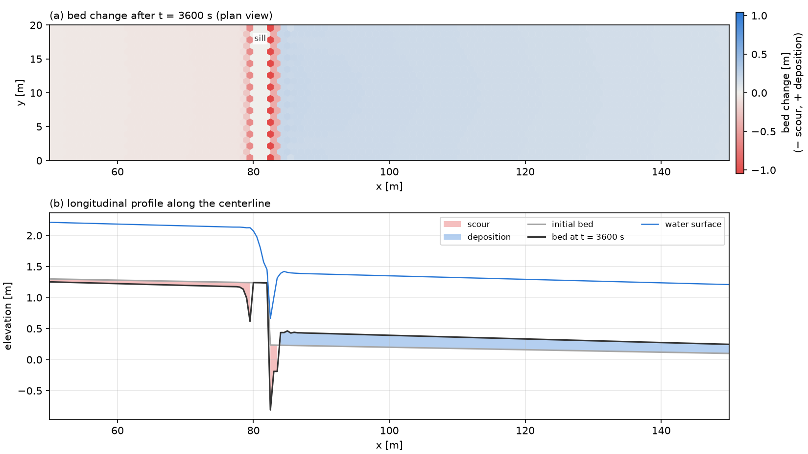
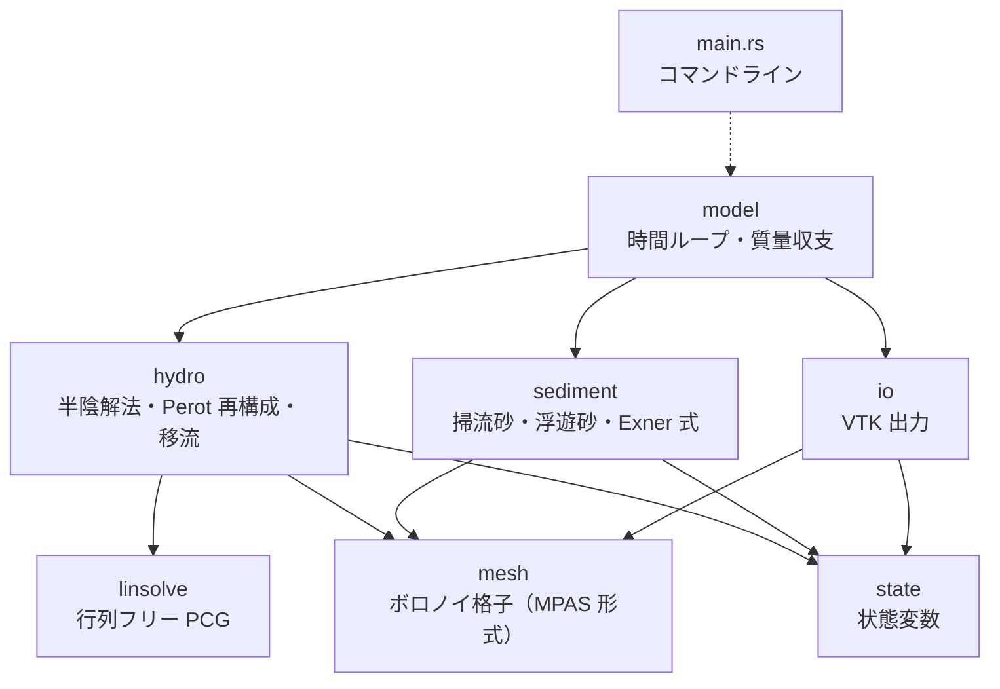
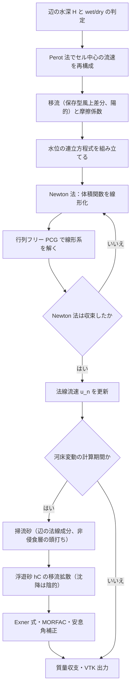
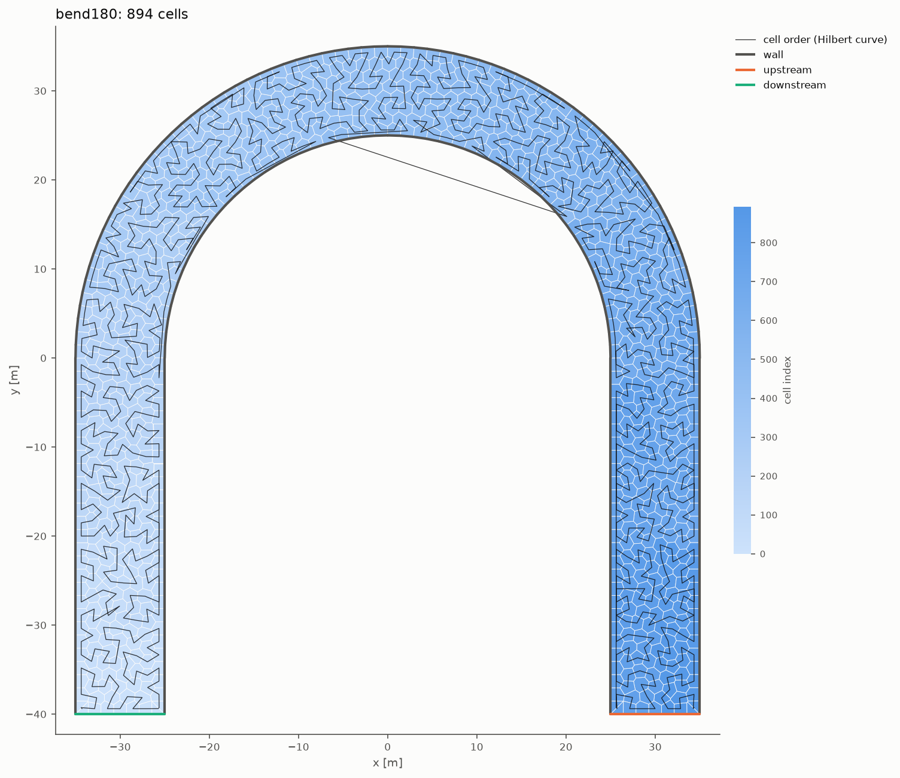

# vormorph

ボロノイ格子・半陰解法による平面二次元河床変動モデル（Rust）

[](https://github.com/yonaka-git/vormorph/actions/workflows/ci.yml)
[](#ライセンス)
[](https://www.rust-lang.org/)

<!--
  ヒーロー画像は現在プレースホルダー（模式図）です。
  床止め例題（examples/sill.toml）の計算結果（河床変動量の平面図と縦断図）ができたら差し替えます。
-->


> **開発状況**：v0.1.0 は開発中です。実装済みなのは、設定ファイルの検証、格子（Python の格子生成ツール（[格子生成](#格子生成)）、直線水路の格子生成、接続配列と幾何量の組み立て、幾何の検査）、Perot 法による流速の再構成、VTK 出力、流れの半陰解法（wet/dry、流量・水位境界、陰的な摩擦、保存型風上差分の移流。ライブラリの `Model::with_state` から使える）です。**流砂はまだ実装していません。** 計算を実行するコマンド（`run`）は、流砂の実装後に動作します。実装の進み具合は[検証](#検証)の表と[ロードマップ](#ロードマップ)に記載しています。

## 特徴（設計）

以下は設計上の特徴です。それぞれの実装状況は[検証](#検証)の表を参照してください。

- **ボロノイ格子上の C 格子（スタガード）配置**：母点を結ぶ線分と境界面が直交する性質を使い、水位勾配と河床の法線方向勾配を2点差分で評価します。接続配列は MPAS 形式です。
- **Casulli 型 θ 法の半陰解法**：水位勾配と摩擦を陰的に扱い、重力波の Courant 条件に縛られません。wet/dry を含む水位の連立方程式（対称正定値）は、Newton 法と行列フリーの前処理付き共役勾配法で解きます。
- **跳水・射流に対応した保存型の移流**：Stelling–Duinmeijer / Kramer–Stelling 系の陽的な保存型風上差分で、堰や床止めの周りの急変流を扱います。
- **辺で評価する流砂と河床変動**：掃流砂は境界面の法線成分で評価します（MPM／芦田・道上を切り替え可能）。長谷川の式による勾配補正、非侵食層（床止め）による流出の頭打ち、浮遊砂、MORFAC、安息角補正を含みます。
- **自作の格子生成ツール（gmsh）**：境界の線分がそのままボロノイ辺になるように、境界に関して対称な母点の対を置き、内部は重心ボロノイ分割にします。セルはヒルベルト曲線の順に並べ、メモリアクセスの局所性を高めます。Rust 側では、ツールの出力を読み込んで MPAS 形式の接続配列と幾何量を組み立てます。
- **小さな依存と検証しやすい構成**：外部クレートは `serde` と `toml` だけです。`unsafe` は使いません。数値計算のループはセル単位で書き、将来の並列化（rayon）に備えます。11 の検証ケースをテストとして管理します。

## 数値解法の要点

辺 $j$ の法線流速は、移流を陽的に、水位勾配を θ 法で、摩擦を陰的に扱って更新します。$1(j)$、$2(j)$ は辺を挟む2つのセル、$\delta_j$ は母点間の距離、$\gamma_j = g n^2 \lvert\mathbf{u}\rvert_j / H_j^{4/3}$ は摩擦係数です。

$$
u_j^{n+1} = G_j - \frac{\theta g \Delta t}{\delta_j\left(1 + \Delta t\,\gamma_j\right)}\left(\eta_{2(j)}^{n+1} - \eta_{1(j)}^{n+1}\right)
$$

これを連続式に代入すると、水位について次の連立方程式が得られます。$V_i(\eta) = A_i \max(\eta - z_{b,i},\ 0)$ は wet/dry で折れる体積関数、$L_j$ は辺の長さです。

$$
V_i\left(\eta_i^{n+1}\right) + \sum_{j\in\partial i} \frac{g\,\theta^2 \Delta t^2\, L_j\, H_j^n}{\delta_j\left(1 + \Delta t\,\gamma_j\right)}\left(\eta_i^{n+1} - \eta_{k(i,j)}^{n+1}\right) = b_i
$$

掃流砂は辺の法線成分を直接評価します。直交性により、法線方向の河床勾配は2点差分になります。

$$
q_{b,j} = \sqrt{s g d^3}\;\Phi\left(\tau_{\ast j}\right)\left[\frac{u_j}{\lvert\mathbf{u}\rvert_j} - \sqrt{\frac{\tau_{\ast c}}{\mu_s \mu_k \tau_{\ast j}}}\;\frac{z_{b,2(j)} - z_{b,1(j)}}{\delta_j}\right]
$$

導出、移流・Perot 再構成・浮遊砂・河床更新の離散式、境界条件は [docs/design/overview.md](docs/design/overview.md) にあります。設計判断の理由は [ADR](docs/design/adr/README.md) に記録しています。

## アーキテクチャ

モジュールの依存関係です。点線は、実装後に使う予定の依存を表します。`config` はほぼすべてのモジュールが参照するので省略しています。



1ステップの計算の流れです。



## 検証

検証ケースは [tests/verification.rs](tests/verification.rs) のテスト関数と 1 対 1 に対応しています。未実装のケースは `#[ignore]` 付きで一覧化しています。合格基準と結果の記録は [docs/verification.md](docs/verification.md) にあります。

状態：✅ 実装済み ／ 🚧 進行中 ／ 📋 予定

| ID | ケース | 確認すること | 状態 |
|---|---|---|---|
| V01 | 格子幾何 | 総面積、直交誤差、各セルが閉じていること | ✅ |
| V02 | Perot 再構成 | 一様流で厳密に一致すること | ✅ |
| V03 | 静水保持（干出する島を含む） | 流速が発生しないこと（well-balanced） | ✅ |
| V04 | 閉鎖水域の振動 | 質量保存、負の水深が出ないこと、Thacker の解析解との比較 | ✅ |
| V05 | ダム破壊 | Ritter / Stoker の解析解との比較 | ✅ |
| V06 | 等流 | マニング式の等流水深に一致すること | ✅ |
| V07 | 跳水 | 共役水深と跳水位置 | ✅ |
| V08 | トレンチ移動 | 浮遊砂の検証 | 📋 |
| V09 | 交互砂州 | 波長と波高 | 📋 |
| V10 | 湾曲水路の河床変動 | 外岸側の洗掘 | 📋 |
| V11 | 床止め下流の局所洗掘 | 洗掘深と格子依存性 | 📋 |

設定ファイルの読み込みと検証、格子ファイルの読み込み、多角形の並びからの接続配列と幾何量の組み立て（不正な格子の検出を含む）、直線水路の格子生成、格子の接続と符号の規約、状態変数の基本操作、VTK 出力（書いたファイルを読み戻して確かめる）、PCG、流れの計算（辺の水深、係数行列の対称性、wet/dry を含む体積の保存、上流端の流量の配分、移流：一様流で 0 になること・運動量の総和・汀線での有界性）、モデルの組み立てには、単体テストがあります（`cargo test` で実行）。格子生成ツールのテストは `uv run --project tools pytest tools/tests` で実行します。

## クイックスタート

### 必要なもの

- Rust（[rustup](https://rustup.rs/) で入れます）。`rust-toolchain.toml` があるので、初回のビルドで stable のツールチェーンが自動で入ります。
  - Linux では、リンカとして C コンパイラが必要です（Ubuntu なら `sudo apt install build-essential`）。
- 格子生成と後処理に使う場合は [uv](https://docs.astral.sh/uv/)（Python の環境は `tools/` で管理します）。
  - 格子生成に使う gmsh は、OpenGL と X11 の共有ライブラリを必要とします（Ubuntu なら `sudo apt install libglu1-mesa libxft2`）。
- 可視化に使う場合は [ParaView](https://www.paraview.org/download/)。

### GitHub Codespaces で動かす

[](https://codespaces.new/yonaka-git/vormorph?quickstart=1)

手元に何も入れずに、ブラウザだけでビルド・テスト・格子生成を試せます。Rust・uv・gmsh 用の共有ライブラリが入った環境（`.devcontainer/`）が立ち上がり、リリースビルドと `tools/` の環境作りまで自動で済みます。長い計算をするときの注意（アイドルタイムアウト）や、計算結果を手元に持ってくる方法は [docs/codespaces.md](docs/codespaces.md) にあります。

### ビルドとテスト

```bash
git clone https://github.com/yonaka-git/vormorph.git
cd vormorph
cargo build --release
cargo test
```

### 例題の実行

```bash
# 設定ファイルの検証（v0.1.0 で動作します）
cargo run --release -- check examples/sill.toml

# 計算の実行（ソルバーの実装後に動作します。v0.1.0 では「未実装」のエラーで終了します）
cargo run --release -- run examples/sill.toml
```

`check` は、設定ファイルを読み込んで値の範囲を検査し、要約を表示します。

```text
examples/sill.toml: OK
title      : sill
mesh       : channel 200 m x 20 m, cell size 1 m, hexagonal
bed        : slope 0.002, z_downstream 0 m
structure  : sill x = 80..82 m, drop 1 m
time       : dt 0.2 s, end 3600 s, morphology from 300 s
hydro      : theta 0.55, Manning n 0.025
sediment   : d 0.002 m, bedload mpm, MORFAC 10, suspended off
upstream   : discharge 40 m^3/s, sediment supply equilibrium
downstream : depth 1.07 m
output     : output/sill every 60 s
```

### 格子生成

計算領域の外形（折れ線・円弧・島）を TOML で書き、格子ファイルを作ります。

```bash
uv sync --project tools
uv run --project tools python tools/make_mesh.py examples/domains/bend.toml \
    -o output/mesh/bend.mesh.toml --plot output/mesh/bend.png
```



- gmsh で境界を格子幅に合わせて分割し、内部に初期の母点を置きます。
- 境界辺ごとに、境界に関して対称な母点と鏡映点の対を置きます。境界の線分がそのままボロノイ辺になり、境界でも直交性が厳密に成り立ちます。
- 内部の母点を Lloyd 法で動かし、重心ボロノイ分割に近づけます。
- セルをヒルベルト曲線の順に並べ、面積・直交性・境界の規約を検査してから書き出します。

手順と格子ファイルの形式は [docs/design/mesh-generation.md](docs/design/mesh-generation.md) にあります。

### ParaView での可視化（ソルバーの実装後）

1. ParaView を[公式サイト](https://www.paraview.org/download/)から入手します。
2. `output/sill/sill.pvd` を開き、「Apply」を押します。
3. 表示する量に `dzb`（河床変動量）や `h`（水深）を選び、時間を進めて変化を確認します。

セルデータの名前と意味は [src/io.rs](src/io.rs) のドキュメントにあります。

### Python での後処理

```bash
uv sync --project tools
uv run --project tools python tools/plot_profile.py output/sill/sill_*.vtu -o profile.png
```

## プロジェクト構成

```text
vormorph/
├── .devcontainer/         GitHub Codespaces の開発環境
├── src/
│   ├── config.rs          TOML 設定の読み込みと検証
│   ├── mesh/              ボロノイ格子（MPAS 形式）、直線水路の生成、格子ファイルの読み込み
│   ├── state.rs           状態変数
│   ├── hydro.rs           半陰解法、Perot 再構成、移流
│   ├── linsolve.rs        行列フリー PCG
│   ├── sediment/          掃流砂・浮遊砂・Exner 式、流砂量式
│   ├── model.rs           時間ループ、質量収支
│   ├── io.rs              VTK 出力
│   └── main.rs            コマンドライン
├── tests/verification.rs  検証ケース
├── examples/
│   ├── sill.toml          床止め下流の局所洗掘（デモ用）
│   └── domains/           格子生成ツールの入力（湾曲水路、島のある池）
├── docs/
│   ├── design/            設計概要（離散式）、格子生成、ADR
│   ├── verification.md    検証計画と結果
│   ├── codespaces.md      GitHub Codespaces での実行
│   └── references.md      参考文献
└── tools/                 Python の格子生成（gmsh）と後処理（uv）
```

## ロードマップ

- [x] v0.1.0：設計文書、モジュールの雛形、設定ファイル、検証ケースの一覧、CI
- [x] 格子生成ツール（gmsh、鏡映対の境界母点、重心ボロノイ分割、ヒルベルト曲線の順）
- [x] 格子：多角形の並びからの接続配列の組み立て、直線水路の生成、格子ファイルの読み込み、幾何の検査（V01）、Perot 再構成（V02）、VTK 出力
- [x] 流れ：半陰解法と wet/dry（V03, V04）、流量・水位境界と摩擦（V06）
- [x] 急変流：保存型風上差分（V05, V07）、V04 の解析解との比較
- [ ] 六角形配置で、止まっている跳水の位置に生じる横断方向の流れの対策（V07 で判明。V11 の前に行う）
- [ ] 河床変動：掃流砂・Exner 式・非侵食層、床止めの例題（V11）とヒーロー画像の差し替え
- [ ] 浮遊砂（V08）
- [ ] 交互砂州・湾曲水路（V09, V10）
- [ ] 以降の候補：混合粒径（平野の交換層モデル）、rayon による並列化、加速流でのエネルギー水頭保存形、局所的に細かい格子

## 参考文献

主要な文献のみを挙げます。全体の一覧と入手方法は [docs/references.md](docs/references.md) にあります。

- Casulli, V., Walters, R. A. (2000). An unstructured grid, three-dimensional model based on the shallow water equations. *Int. J. Numer. Meth. Fluids*, 32(3), 331–348.
- Casulli, V. (2009). A high-resolution wetting and drying algorithm for free-surface hydrodynamics. *Int. J. Numer. Meth. Fluids*, 60(4), 391–408. <https://doi.org/10.1002/fld.1896>
- Stelling, G. S., Duinmeijer, S. P. A. (2003). A staggered conservative scheme for every Froude number in rapidly varied shallow water flows. *Int. J. Numer. Meth. Fluids*, 43(12), 1329–1354. <https://doi.org/10.1002/fld.537>
- Kramer, S. C., Stelling, G. S. (2008). A conservative unstructured scheme for rapidly varied flows. *Int. J. Numer. Meth. Fluids*, 58(2), 183–212. <https://doi.org/10.1002/fld.1722>
- Perot, B. (2000). Conservation properties of unstructured staggered mesh schemes. *J. Comput. Phys.*, 159(1), 58–89. <https://doi.org/10.1006/jcph.2000.6424>
- Geuzaine, C., Remacle, J.-F. (2009). Gmsh: A 3-D finite element mesh generator with built-in pre- and post-processing facilities. *Int. J. Numer. Meth. Engng*, 79(11), 1309–1331. <https://doi.org/10.1002/nme.2579>
- Abdelkader, A., et al. (2018). Sampling conditions for conforming Voronoi meshing by the VoroCrust algorithm. *SoCG 2018*, LIPIcs 99, 1:1–1:16. <https://doi.org/10.4230/LIPIcs.SoCG.2018.1>
- Du, Q., Faber, V., Gunzburger, M. (1999). Centroidal Voronoi tessellations: applications and algorithms. *SIAM Review*, 41(4), 637–676. <https://doi.org/10.1137/S0036144599352836>
- 芦田和男, 道上正規 (1972). 移動床流れの抵抗と掃流砂量に関する基礎的研究. *土木学会論文報告集*, 206, 59–69. <https://doi.org/10.2208/jscej1969.1972.206_59>

## 作者

yonaka — GitHub: [@yonaka-git](https://github.com/yonaka-git)

## ライセンス

次のいずれかのライセンスを、利用者が選んで適用できます。

- Apache License, Version 2.0（[LICENSE-APACHE](LICENSE-APACHE)）
- MIT License（[LICENSE-MIT](LICENSE-MIT)）

特に明示しない限り、このプロジェクトに提供された貢献は、Apache-2.0 ライセンスの定義に従い、追加の条件なしに上記のデュアルライセンスで提供されるものとします。
