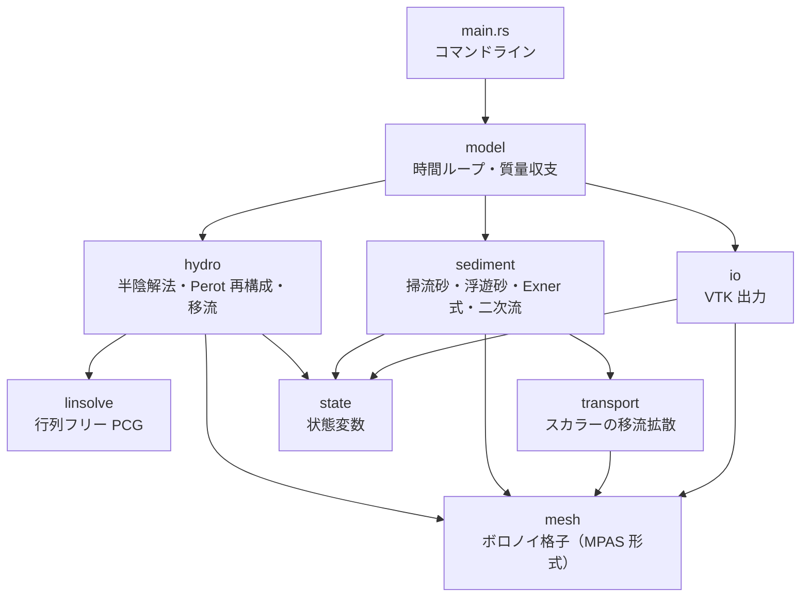
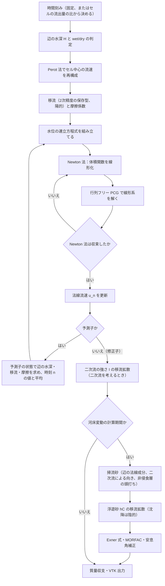

# vormorph

ボロノイ格子・半陰解法による平面二次元河床変動モデル（Rust）

[](https://github.com/yonaka-git/vormorph/actions/workflows/ci.yml)
[](#ライセンス)
[](https://www.rust-lang.org/)


*`examples/sill.toml` の計算結果（落差 1 m の床止め、流量 40 m³/s、粒径 2 mm、MORFAC 10、3600 s）。床止めの直下が 1.05 m 洗掘され、下流に最大 0.23 m 堆積し、床止めの上流は水面低下でわずかに下がります（既定の2次の移流と予測子・修正子。1次の移流では洗掘 0.68 m・堆積 0.41 m で、天端の水深が過小になるぶん上流の水面低下と堆積が大きく出ました）。床止めの直下の洗掘孔は1セルの幅で、深さは格子幅に依存します（[検証](docs/verification.md#床止めの例題既定の移流と時間積分を変えた後参考2026-11-07)）。図は `tools/plot_sill.py` で描きました。*

> **開発状況**：v0.1.0 は開発中です。実装済みなのは、設定ファイルの検証、格子（Python の格子生成ツール（[格子生成](#格子生成)）、直線水路の格子生成（上流端と下流端をつないだ周期的な水路を含む）、接続配列と幾何量の組み立て、幾何の検査）、Perot 法による流速の再構成、VTK 出力、流れの半陰解法（wet/dry、流量・水位境界、周期境界、陰的な摩擦、2次精度の保存型の移流と予測子・修正子の時間積分。1次の風上差分も選べる）、時間刻みの決め方（固定、またはクーラン数で決める可変）、掃流砂と河床変動（辺で評価する掃流砂、長谷川の式による勾配補正、非侵食層、Exner 式、MORFAC、安息角補正、湾曲部の二次流による掃流砂の向きの補正）、設定からのモデルの組み立てと計算の実行（`vormorph run`。直線水路と、格子生成ツールの格子＋セルの値のファイルの河床）、交互砂州の線形安定解析（`tools/bar_theory.py`）と、それとの比較（V09）です。**浮遊砂はまだ実装していません。**実装の進み具合は[検証](#検証)の表と[ロードマップ](#ロードマップ)に記載しています。

## 特徴（設計）

以下は設計上の特徴です。それぞれの実装状況は[検証](#検証)の表を参照してください。

- **ボロノイ格子上の C 格子（スタガード）配置**：母点を結ぶ線分と境界面が直交する性質を使い、水位勾配と河床の法線方向勾配を2点差分で評価します。接続配列は MPAS 形式です。
- **Casulli 型 θ 法の半陰解法**：水位勾配と摩擦を陰的に扱い、重力波の Courant 条件に縛られません。wet/dry を含む水位の連立方程式（対称正定値）は、Newton 法と行列フリーの前処理付き共役勾配法で解きます。時間刻みは、陽的に扱う部分の条件（セルから1ステップで流出する体積がセルの体積を超えないこと）から、ステップごとに決められます。
- **跳水・射流に対応した保存型の移流**：Stelling–Duinmeijer / Kramer–Stelling 系の陽的な保存型風上差分で、堰や床止めの周りの急変流を扱います。既定は、最小二乗の勾配で面の値を再構成する2次精度の形です。跳水の釣り合い（Bélanger の式）を保ち、陽的な部分だけを予測子・修正子（Heun 法）で平均することで、重力波を余分に減衰させずにクーラン数 1 まで安定にしています（ADR-0016〜0018）。
- **辺で評価する流砂と河床変動**：掃流砂は境界面の法線成分で評価します（MPM／芦田・道上を切り替え可能。河床波の形状抵抗は砂漣係数で除けます）。長谷川の式による勾配補正、非侵食層（床止め）による流出の頭打ち、浮遊砂、MORFAC、安息角補正を含みます。湾曲部では、二次流の強さを輸送方程式（遠心加速度を流速の勾配から求めた生成項と、適応長での緩和）で求め、掃流砂の向きを内岸側へ回します（ADR-0019）。
- **自作の格子生成ツール（gmsh）**：境界の線分がそのままボロノイ辺になるように、境界に関して対称な母点の対を置き、内部は重心ボロノイ分割にします。セルはヒルベルト曲線の順に並べ、メモリアクセスの局所性を高めます。Rust 側では、ツールの出力を読み込んで MPAS 形式の接続配列と幾何量を組み立てます。
- **小さな依存と検証しやすい構成**：外部クレートは `serde` と `toml` だけです。`unsafe` は使いません。数値計算のループはセル単位で書き、将来の並列化（rayon）に備えます。12 の検証ケースをテストとして管理します。

## 数値解法の要点

辺 $j$ の法線流速は、移流を陽的に、水位勾配を θ 法で、摩擦を陰的に扱って更新します。$1(j)$、$2(j)$ は辺を挟む2つのセル、$\delta_j$ は母点間の距離、$\gamma_j = g n^2 \lvert\mathbf{u}\rvert_j / H_j^{4/3}$ は摩擦係数です。

$$
u_j^{n+1} = G_j - \frac{\theta g \Delta t}{\delta_j\left(1 + \Delta t\,\gamma_j\right)}\left(\eta_{2(j)}^{n+1} - \eta_{1(j)}^{n+1}\right)
$$

これを連続式に代入すると、水位について次の連立方程式が得られます。$V_i(\eta) = A_i \max(\eta - z_{b,i},\ 0)$ は wet/dry で折れる体積関数、$L_j$ は辺の長さです。

$$
V_i\left(\eta_i^{n+1}\right) + \sum_{j\in\partial i} \frac{g\,\theta^2 \Delta t^2\, L_j\, H_j^n}{\delta_j\left(1 + \Delta t\,\gamma_j\right)}\left(\eta_i^{n+1} - \eta_{k(i,j)}^{n+1}\right) = b_i
$$

掃流砂は辺の法線成分を直接評価します。直交性により、法線方向の河床勾配は2点差分になります。

$$
q_{b,j} = \sqrt{s g d^3}\;\Phi\left(\tau_{\ast j}\right)\left[\frac{u_j}{\lvert\mathbf{u}\rvert_j} - \sqrt{\frac{\tau_{\ast c}}{\mu_s \mu_k \tau_{\ast j}}}\;\frac{z_{b,2(j)} - z_{b,1(j)}}{\delta_j}\right]
$$

導出、移流・Perot 再構成・浮遊砂・河床更新の離散式、境界条件は [docs/design/overview.md](docs/design/overview.md) にあります。設計判断の理由は [ADR](docs/design/adr/README.md) に記録しています。

## アーキテクチャ

モジュールの依存関係です。`config` はほぼすべてのモジュールが参照するので省略しています。



1ステップの計算の流れです。



## 検証

検証ケースは [tests/verification.rs](tests/verification.rs) のテスト関数と 1 対 1 に対応しています。未実装のケースは `#[ignore]` 付きで一覧化しています。合格基準と結果の記録は [docs/verification.md](docs/verification.md) にあります。

状態：✅ 実装済み ／ 🚧 進行中 ／ 📋 予定

| ID | ケース | 確認すること | 状態 |
|---|---|---|---|
| V01 | 格子幾何 | 総面積、直交誤差、各セルが閉じていること | ✅ |
| V02 | Perot 再構成 | 一様流で厳密に一致すること | ✅ |
| V03 | 静水保持（干出する島を含む） | 流速が発生しないこと（well-balanced） | ✅ |
| V04 | 閉鎖水域の振動 | 質量保存、負の水深が出ないこと、Thacker の解析解との比較 | ✅ |
| V05 | ダム破壊 | Ritter / Stoker の解析解との比較 | ✅ |
| V06 | 等流 | マニング式の等流水深に一致すること | ✅ |
| V07 | 跳水 | 共役水深と跳水位置 | ✅ |
| V08 | トレンチ移動 | 浮遊砂の検証 | 📋 |
| V09 | 交互砂州 | 線形安定解析の成長率と移動速度（周期境界。二次流による掃流砂の向きの補正ありを含む）。有限振幅の波長と波高は未実装 | 🚧 |
| V10 | 湾曲水路の河床変動 | 外岸側の洗掘 | 📋 |
| V11 | 河床のこぶの移動 | 移動速度と、格子を細かくしたときの縦断形の収束 | ✅ |
| V12 | 平衡河床の保持 | 等流に平衡給砂を与えると河床が変わらないこと | ✅ |

設定ファイルの読み込みと検証、格子ファイルとセルの値のファイルの読み込み（母点の座標による照合、格子ファイルからのモデルの組み立て。`tests/cell_values.rs`）、多角形の並びからの接続配列と幾何量の組み立て（不正な格子の検出を含む）、直線水路の格子生成、格子の接続と符号の規約、状態変数の基本操作、VTK 出力（書いたファイルを読み戻して確かめる）、PCG、流れの計算（辺の水深、係数行列の対称性、wet/dry を含む体積の保存、上流端の流量の配分、セルの流出量の比、移流：一様流で 0 になること・1次元の定常跳水の釣り合い（Bélanger の式）・六角形配置の格子規模の乱れの減衰・汀線での有界性）、掃流砂と河床の更新（流砂量式の値、等流で全辺の流砂量が一致すること、土砂の質量保存、非侵食層で止まること、安息角補正、湛水セルの水位の保持）、二次流（剛体回転の流れの平衡値、汀線での扱い、適応長、緩和と1次の収束、一様な値の保存、掃流砂の向き、横断勾配の平衡）、モデルの組み立て（母点で評価する河床高と床止め、可変の時間刻みの上限とクーラン数、出力時刻にちょうど止まること、移動床の土砂と水の収支）、格子生成ツールの格子の凸な角に接するセルの河床変動（`tests/corner_cells.rs`）、周期境界の継ぎ目が計算に跡を残さないこと（`tests/periodic_channel.rs`）、コマンドライン（`tests/cli.rs`）には、テストがあります（`cargo test` で実行）。格子生成ツールのテストは `uv run --project tools pytest tools/tests` で実行します。

## クイックスタート

### 必要なもの

- Rust（[rustup](https://rustup.rs/) で入れます）。`rust-toolchain.toml` があるので、初回のビルドで stable のツールチェーンが自動で入ります。
  - Linux では、リンカとして C コンパイラが必要です（Ubuntu なら `sudo apt install build-essential`）。
- 格子生成と後処理に使う場合は [uv](https://docs.astral.sh/uv/)（Python の環境は `tools/` で管理します）。
  - 格子生成に使う gmsh は、OpenGL と X11 の共有ライブラリを必要とします（Ubuntu なら `sudo apt install libglu1-mesa libxft2`）。
- 可視化に使う場合は [ParaView](https://www.paraview.org/download/)。

### GitHub Codespaces で動かす

[](https://codespaces.new/yonaka-git/vormorph?quickstart=1)

手元に何も入れずに、ブラウザだけでビルド・テスト・格子生成を試せます。Rust・uv・gmsh 用の共有ライブラリが入った環境（`.devcontainer/`）が立ち上がり、リリースビルドと `tools/` の環境作りまで自動で済みます。長い計算をするときの注意（アイドルタイムアウト）や、計算結果を手元に持ってくる方法は [docs/codespaces.md](docs/codespaces.md) にあります。

### ビルドとテスト

```bash
git clone https://github.com/yonaka-git/vormorph.git
cd vormorph
cargo build --release
cargo test
```

### 例題の実行

```bash
# 設定ファイルの検証
cargo run --release -- check examples/sill.toml

# 計算の実行（掃流砂による河床変動。数分かかります）
cargo run --release -- run examples/sill.toml
```

`check` は、設定ファイルを読み込んで値の範囲を検査し、要約を表示します。

```text
examples/sill.toml: OK
title      : sill
mesh       : channel 200 m x 20 m, cell size 1 m, hexagonal
bed        : slope 0.002, z_downstream 0 m
structure  : sill x = 80..82 m, drop 1 m
time       : adaptive dt (Courant 0.8, dt <= 0.2 s), end 3600 s, morphology from 600 s
hydro      : theta 0.55, Manning n 0.025, advection second_order, time integration predictor_corrector
sediment   : d 0.002 m, bedload mpm, MORFAC 10, suspended off
upstream   : discharge 40 m^3/s, sediment supply equilibrium
downstream : water level 1.07 m
output     : output/sill every 60 s
```

`run` は、出力時刻ごとに、時刻・ステップ数・時間刻み・クーラン数（セルの流出量の比の最大値）・Newton 法と PCG の反復回数（予測子・修正子では2回の合計）・水の収支の誤差（流入量と初期の体積の和に対する比）を1行ずつ表示します。移流の安全策（局所クーラン数が 1 を超えた辺で重みを頭打ちにする）が働いたときは、その辺の数も表示します（乾いた河床に水が流れ込み始めた直後など）。河床変動の計算（`morphology_start` の後）では、1ステップの河床の変化の最大値と、土砂の収支の誤差も表示します。`examples/sill.toml` の出力の一部です（乾いた河床から始め、600 s から河床変動を計算します）。

```text
running 'sill': 4589 cells, 13768 edges, until t = 3600 s, output to output/sill
t =      60.00 s |     393 steps | dt 0.0035..0.2000 s | Courant 0.800 | Newton <= 2 | PCG 25.9/step | water balance -6.9e-13 | advection limited on 12 edges
...
t =     600.00 s |     592 steps | dt 0.0516..0.1015 s | Courant 0.800 | Newton <= 2 | PCG 18.0/step | water balance -6.8e-14
t =     660.00 s |     861 steps | dt 0.0556..0.1015 s | Courant 0.800 | Newton <= 2 | PCG 15.6/step | water balance -6.1e-14 | bed change <= 1.09e-1 m/step | sediment balance -1.4e-15
...
t =    3600.00 s |     797 steps | dt 0.0585..0.0753 s | Courant 0.800 | Newton <= 2 | PCG 16.0/step | water balance -4.7e-15 | bed change <= 7.00e-4 m/step | sediment balance 1.4e-14
finished: t = 3600 s, 46549 steps, 279.9 s wall time
```

### 格子生成

計算領域の外形（折れ線・円弧・島）を TOML で書き、格子ファイルを作ります。

```bash
uv sync --project tools
uv run --project tools python tools/make_mesh.py examples/domains/bend.toml \
    -o output/mesh/bend.mesh.toml --plot output/mesh/bend.png
```


- gmsh で境界を格子幅に合わせて分割し、内部に初期の母点を置きます。
- 境界辺ごとに、境界に関して対称な母点と鏡映点の対を置きます。境界の線分がそのままボロノイ辺になり、境界でも直交性が厳密に成り立ちます。
- 内部の母点を Lloyd 法で動かし、重心ボロノイ分割に近づけます。
- セルをヒルベルト曲線の順に並べ、面積・直交性・境界の規約を検査してから書き出します。

河床高は、領域の定義の `[bed]`（中心線に沿った一様な勾配か平面）から、格子の母点で求めて別のファイル（セルの値のファイル）に書きます（[ADR-0020](docs/design/adr/0020-cell-values-file.md)）。設定では `[mesh] kind = "file"` の `path` に格子ファイル、`cells` にこのファイルを指定します。

```bash
uv run --project tools python tools/make_bed.py examples/domains/bend.toml \
    output/mesh/bend.mesh.toml -o output/mesh/bend.cells.toml
```

手順と格子ファイルの形式は [docs/design/mesh-generation.md](docs/design/mesh-generation.md) にあります。

### ParaView での可視化

1. ParaView を[公式サイト](https://www.paraview.org/download/)から入手します。
2. `output/sill/sill.pvd` を開き、「Apply」を押します。
3. 表示する量に `dzb`（河床変動量）や `h`（水深）を選び、時間を進めて変化を確認します。

セルデータの名前と意味は [src/io.rs](src/io.rs) のドキュメントにあります。

### Python での後処理

```bash
uv sync --project tools
uv run --project tools python tools/plot_profile.py output/sill/sill_*.vtu -o profile.png
# 河床変動量の平面図と縦断図（README の冒頭の図）
uv run --project tools python tools/plot_sill.py output/sill/sill.pvd -o hero.png
```

## プロジェクト構成

```text
vormorph/
├── .devcontainer/         GitHub Codespaces の開発環境
├── src/
│   ├── config.rs          TOML 設定の読み込みと検証
│   ├── mesh/              ボロノイ格子（MPAS 形式）、直線水路の生成、格子ファイル・セルの値のファイルの読み込み、最小二乗の勾配
│   ├── state.rs           状態変数
│   ├── hydro.rs           半陰解法、Perot 再構成、移流（1次・2次）、予測子・修正子
│   ├── linsolve.rs        行列フリー PCG
│   ├── transport.rs       セル中心のスカラーの移流拡散（二次流の強さ）
│   ├── sediment/          掃流砂・浮遊砂・Exner 式、流砂量式、二次流
│   ├── model.rs           時間ループ、質量収支
│   ├── io.rs              VTK 出力
│   └── main.rs            コマンドライン
├── tests/verification.rs  検証ケース
├── examples/
│   ├── sill.toml          床止め下流の局所洗掘（デモ用）
│   └── domains/           格子生成ツールの入力（湾曲水路、島のある池）
├── docs/
│   ├── design/            設計概要（離散式）、格子生成、ADR
│   ├── verification.md    検証計画と結果
│   ├── codespaces.md      GitHub Codespaces での実行
│   └── references.md      参考文献
└── tools/                 Python の格子生成（gmsh）と後処理（uv）
```

## ロードマップ

- [x] v0.1.0：設計文書、モジュールの雛形、設定ファイル、検証ケースの一覧、CI
- [x] 格子生成ツール（gmsh、鏡映対の境界母点、重心ボロノイ分割、ヒルベルト曲線の順）
- [x] 格子：多角形の並びからの接続配列の組み立て、直線水路の生成、格子ファイルの読み込み、幾何の検査（V01）、Perot 再構成（V02）、VTK 出力
- [x] 流れ：半陰解法と wet/dry（V03, V04）、流量・水位境界と摩擦（V06）
- [x] 急変流：保存型風上差分（V05, V07）、V04 の解析解との比較
- [x] 六角形配置で、止まっている跳水の位置に生じる横断方向の流れの対策（V07 で判明。移流で辺の流速を上流の流速へ近づける形にした。ADR-0009）
- [x] 河床変動：掃流砂・Exner 式・非侵食層・安息角補正、可変の時間刻みと `vormorph run`、こぶの移動（V11）と平衡河床の保持（V12）、床止めの例題とヒーロー画像の差し替え。床止めの直下の局所洗掘は格子に依存することがわかったので、V11 はこぶの移動に変えた（[検証](docs/verification.md)）
- [ ] 交互砂州・湾曲水路（V09, V10）：直線水路の周期境界（ADR-0014, 0015）と、交互砂州の線形安定解析との比較（V09。1次の数値拡散で、粗い格子では成長率が小さく出ることがわかった）、2次精度の移流と予測子・修正子の時間積分（ADR-0016〜0018。既定）、二次流による掃流砂の向きの補正（ADR-0019。V09 で二次流を含めた線形理論と比較）、格子生成ツールの格子の河床（セルの値のファイル。ADR-0020）まで実装済み
- [ ] 浮遊砂（V08）
- [ ] 以降の候補：混合粒径（平野の交換層モデル）、rayon による並列化、加速流でのエネルギー水頭保存形、局所的に細かい格子

## 参考文献

主要な文献のみを挙げます。全体の一覧と入手方法は [docs/references.md](docs/references.md) にあります。

- Casulli, V., Walters, R. A. (2000). An unstructured grid, three-dimensional model based on the shallow water equations. *Int. J. Numer. Meth. Fluids*, 32(3), 331–348.
- Casulli, V. (2009). A high-resolution wetting and drying algorithm for free-surface hydrodynamics. *Int. J. Numer. Meth. Fluids*, 60(4), 391–408. <https://doi.org/10.1002/fld.1896>
- Stelling, G. S., Duinmeijer, S. P. A. (2003). A staggered conservative scheme for every Froude number in rapidly varied shallow water flows. *Int. J. Numer. Meth. Fluids*, 43(12), 1329–1354. <https://doi.org/10.1002/fld.537>
- Kramer, S. C., Stelling, G. S. (2008). A conservative unstructured scheme for rapidly varied flows. *Int. J. Numer. Meth. Fluids*, 58(2), 183–212. <https://doi.org/10.1002/fld.1722>
- Perot, B. (2000). Conservation properties of unstructured staggered mesh schemes. *J. Comput. Phys.*, 159(1), 58–89. <https://doi.org/10.1006/jcph.2000.6424>
- Geuzaine, C., Remacle, J.-F. (2009). Gmsh: A 3-D finite element mesh generator with built-in pre- and post-processing facilities. *Int. J. Numer. Meth. Engng*, 79(11), 1309–1331. <https://doi.org/10.1002/nme.2579>
- Abdelkader, A., et al. (2018). Sampling conditions for conforming Voronoi meshing by the VoroCrust algorithm. *SoCG 2018*, LIPIcs 99, 1:1–1:16. <https://doi.org/10.4230/LIPIcs.SoCG.2018.1>
- Du, Q., Faber, V., Gunzburger, M. (1999). Centroidal Voronoi tessellations: applications and algorithms. *SIAM Review*, 41(4), 637–676. <https://doi.org/10.1137/S0036144599352836>
- 芦田和男, 道上正規 (1972). 移動床流れの抵抗と掃流砂量に関する基礎的研究. *土木学会論文報告集*, 206, 59–69. <https://doi.org/10.2208/jscej1969.1972.206_59>

## 作者

yonaka — GitHub: [@yonaka-git](https://github.com/yonaka-git)

## ライセンス

次のいずれかのライセンスを、利用者が選んで適用できます。

- Apache License, Version 2.0（[LICENSE-APACHE](LICENSE-APACHE)）
- MIT License（[LICENSE-MIT](LICENSE-MIT)）

特に明示しない限り、このプロジェクトに提供された貢献は、Apache-2.0 ライセンスの定義に従い、追加の条件なしに上記のデュアルライセンスで提供されるものとします。
