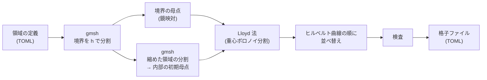
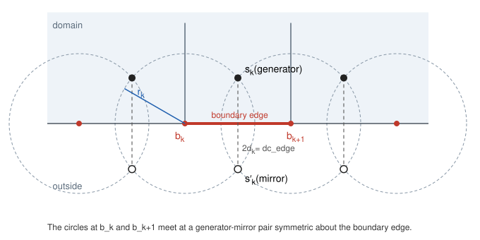
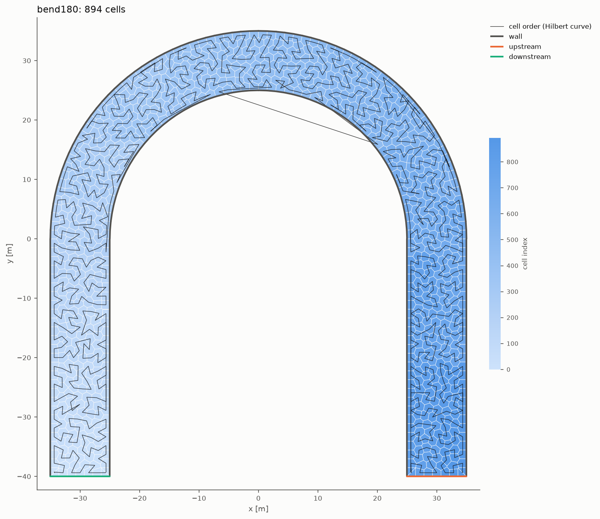

# 格子生成

この文書は、格子生成ツール `tools/make_mesh.py`（Python パッケージ `tools/vormesh/`）の手順と、ツールが書き出す格子ファイルの形式、格子の母点で河床高を求めるツール `tools/make_bed.py` とセルの値のファイルの形式をまとめたものです。判断の理由は [ADR-0005](adr/0005-mesh-generator.md)（格子生成）と [ADR-0020](adr/0020-cell-values-file.md)（セルの値のファイル）にあります。

## 1. 位置づけ

| 格子 | 作り方 | 用途 |
|---|---|---|
| 直線矩形水路 | Rust の `mesh::channel` が内部で生成する。`build_periodic` は上流端と下流端をつないだ周期的な水路を作る（[ADR-0014](adr/0014-periodic-channel.md)） | 検証ケース V01・V02・V05〜V07・V11・V12、交互砂州（V09） |
| 任意の平面形（湾曲、島、合流など） | `tools/make_mesh.py` で格子ファイルを作り、Rust の `mesh::file` が読む。河床高は `tools/make_bed.py` でセルの値のファイルを作り、`mesh::cells` が読む（7.2 節） | 検証ケース V10、島や橋脚のある領域、実河川への適用 |

格子生成ツールは、[gmsh](https://gmsh.info/)（Geuzaine & Remacle, 2009）を境界の分割と初期の母点の配置に使い、ボロノイ格子そのものは自前で作ります。セルはヒルベルト曲線の順に並べて書き出します。

## 2. 手順



1. **境界の分割**：gmsh の組み込みカーネルで領域（折れ線・円弧・穴）を作り、境界を目標の格子幅 $h$ で分割して、境界の節点 $b_k$ を取り出します。
2. **境界の母点**：境界辺ごとに、境界に関して対称な母点と鏡映点の対を置きます（3 節）。母点は境界から約 $\tfrac{\sqrt{3}}{4}h \approx 0.43h$ の位置に並びます。
3. **内部の初期母点**：領域を境界から $\tfrac{\sqrt{3}}{4}h$ だけ内側に縮めた多角形を、gmsh の Frontal-Delaunay 法で三角形分割し、その内部の節点を初期の母点にします。縮めた多角形の境界が境界の母点の列にあたるので、内部の母点はその次の列（正六角形の格子の列の間隔 $\tfrac{\sqrt{3}}{2}h$ だけ内側）から始まります。
4. **数の調整**：境界の円（3 節）の内側にある初期母点を除きます。gmsh の分割は正六角形の格子より数％密なので、母点の総数が正六角形の格子の個数 $A/(\tfrac{\sqrt{3}}{2}h^2)$ になるまで、最も混み合った内部の母点から間引きます（$A$ は領域の面積）。
5. **Lloyd 法**：境界の母点を固定し、内部の母点を各セルの重心へ移す操作を、移動量の二乗平均平方根が $10^{-3}h$ を下回るまで（既定で最大 100 回）繰り返します。重心ボロノイ分割（CVT; Lloyd, 1982; Du et al., 1999）に近づきます。円に接して行き来する少数の母点があり、移動量の最大値は下がりきらないことがあるので、判定には二乗平均平方根を使います。
6. **並べ替え**：母点をヒルベルト曲線の順に並べ、頂点の番号もその順につけます（4 節）。
7. **検査と書き出し**：5 節の項目を検査し、通れば格子ファイル（7 節）を書き出します。

### 座標の扱い

gmsh を使う手順 1・3 のあとは、外周の外接矩形の左下の点を 1 m 単位に切り下げて原点にし、局所座標で計算します。書き出すときに原点を足し戻すので、格子ファイルの座標は領域の定義と同じ座標です。

平面直角座標のように座標の値が大きいまま計算すると、桁落ちが起きるためです。

- **重心**：shoelace の式で重心を求めると、原点から $X$ 離れた面積 $A$ のセルで、重心におよそ $arepsilon X^3/A$（$arepsilon pprox 2.2	imes 10^{-16}$）の誤差が生じます。$X = 10^5$ m、$A = 1$ m² で約 0.1 m です。そこで重心は、局所座標のうえで、さらにセルの頂点の平均を原点にして計算します。
- **ボロノイ図**：4つの母点がほぼ同じ円の上に乗る配置では、ごく短い辺ができます。座標の値が大きいと、ボロノイ図を計算する Qhull がこの辺を精度の範囲内とみなしてつぶし、隣の辺の向きがずれて、直交性の検査（5 節）に落ちることがあります。格子幅 0.5 m の例では $\lvert\cos\rvert = 2\times 10^{-4}$ になりました（同じ母点を局所座標で計算すると $5\times 10^{-11}$）。

原点の近くの島の池（`examples/domains/island.toml`）を $(10^5, 10^5)$ m 平行移動して試すと、局所座標にする前は、重心の誤差が格子幅 1.5 m で 0.07 m、0.5 m で 0.7 m ありました。そのため 1.5 m では Lloyd 法が収束せず、0.5 m では生成が失敗しました。局所座標にすると、どちらも原点の近くと同じ品質の格子ができます。

Rust 側（`mesh::voronoi::compute_geometry`）は、面積を母点を原点にして求め、辺の長さ・法線・母点間の距離を座標の差から求めているので、この桁落ちは起きません。

## 3. 境界の扱い（鏡映対の母点）

境界の折れ線の節点 $b_k$ を中心に、半径 $r_k$ の円を描きます。隣り合う2つの円 $(b_k, r_k)$ と $(b_{k+1}, r_{k+1})$ の交点は

$$
\mathbf{p}_\pm = \mathbf{b}_k + a_k \mathbf{t}_k \pm d_k \mathbf{n}_k, \qquad
a_k = \frac{r_k^2 - r_{k+1}^2 + L_k^2}{2L_k}, \qquad
d_k = \sqrt{r_k^2 - a_k^2}
$$

です。$L_k$ は辺 $b_k b_{k+1}$ の長さ、$\mathbf{t}_k$ と $\mathbf{n}_k$ はその単位接線と単位法線です。2つの交点は辺の直線に関して対称なので、領域の内側の点を境界辺 $k$ の**母点**、外側の点をその**鏡映点**とします（Abdelkader et al., 2018 の VoroCrust と同じ考え方の2次元版）。



この配置には、次の性質があります。

- 母点と鏡映点の二等分線は辺の直線そのものなので、**境界の線分 $b_k b_{k+1}$ がそのままボロノイ辺になります**。母点と鏡映点を結ぶ線分は辺に直交し、その長さ $2d_k$ が Rust 側の境界辺の `dc_edge`（鏡映点までの距離）になります。
- 節点 $b_k$ の円の上には、隣り合う2つの対の4点が乗ります。円の内側にほかの母点がなければ、$b_k$ はボロノイ頂点になります（Delaunay 分割の空円の性質）。ツールは内部の母点を円の外に置き、境界の母点についてもこの条件を検査します。
- 領域で切り取る操作が要らないので、凹な角（島の角や合流部）の裏側にボロノイ領域が回り込む問題が起きません。

半径は $r_k = 0.66 \times (L_{k-1} + L_k)/2$ とします。境界を一様な長さ $h$ で分割した場合は $d_k \approx 0.43h$ になり、境界に平行な正六角形の列（列の間隔 $\tfrac{\sqrt{3}}{2}h$）の半分の位置に母点が来ます。凸な角は 90° まで扱えます（それより鋭い角では、隣の隣の円が母点を含んでしまいます）。凹な角には制限がありません。

### 壁ぎわのセルの母点と重心

計算の中心（水位・河床高を置く点）は、すべてのセルで母点です。壁は母点と鏡映点の二等分線なので、母点は壁から約 $0.43h$ 内側にあり、中心が壁の上に乗る「半分のセル」はありません。

セルの流速は Perot 法で辺の法線流速から再構成するので、母点と重心がずれていると、流速の勾配のある所で誤差が出ます。格子幅 0.5 m の島の池（`examples/domains/island.toml`）で測った値は次のとおりです。誤差は、一次の流速場（勾配の成分が ±0.2 1/s の4通り）の法線成分を辺に与えて再構成した流速と、母点での厳密な値との差を、1セル分の流速の変化 $0.2h$ で割った最大値です。

| セル | 重心と母点のずれ / $h$ | Perot 法の誤差 |
|---|---|---|
| 内部 | 最大 0.012 | 0.06〜0.10 |
| 直線の壁ぎわ | 中央値 0.016、最大 0.056 | 0.08〜0.11（内部の 1.1〜1.7 倍）。島の周りも含む |
| 外周の凸な角（90°）に接するセル | 約 0.19 | 0.09〜0.60（8 節） |

壁ぎわの誤差は内部と大きく変わらないので、中心は母点のままにします。中心を重心に移すと、母点を結ぶ線が辺に直交しなくなり、水位勾配の2点差分が厳密でなくなります（[ADR-0001](adr/0001-voronoi-grid.md)）。

この性質は、Rust 側のテストで確かめています。

- `tests/mesh_file.rs`：ツールの格子で、凸な角を除いた壁ぎわのセルの誤差が 0.15 未満であること。
- `hydro` の単体テスト：直線水路の側壁ぎわのセルの誤差が、正方形配置で 0（丸め誤差）、六角形配置で 0.1 未満であること。

## 4. ヒルベルト曲線の順

セルを母点のヒルベルト曲線上の位置の順に並べます。

- **方法**：母点の外接正方形（x と y で同じ縮尺）を $2^{16} \times 2^{16}$ に分け、各母点の整数座標からヒルベルト指数（Hilbert, 1891 の曲線の離散版）を計算して、安定な並べ替えをします。縮尺を x と y でそろえるので、細長い領域でも曲線はゆがみません。
- **頂点**：セルを番号順にたどり、各セルの頂点を反時計回りにたどって、初めて現れた順に番号をつけます。
- **辺**：Rust 側（`mesh::voronoi::build`）で、同じくセルの順に初めて現れた順に番号をつけます。

番号の近いセルが空間的にも近くなるので、セル単位のループで参照する隣のセル・辺・頂点のデータがメモリ上でも近くに集まります。番号の連続した範囲で領域を分けると、まとまった形の部分領域になるので、将来 rayon で並列化するときの分割にもそのまま使えます（Bader, 2013）。

ヒルベルト曲線は外接正方形の全体をたどるので、曲線が領域の外（下の図では U 字の内側）を通るところでは、番号の隣り合うセルが離れます。このような飛びは曲線が領域を出入りする回数だけで、全体の局所性はほとんど損なわれません。



上の図は `examples/domains/bend.toml` を格子幅 1.5 m で生成した結果です（格子生成ツールの実際の出力）。

## 5. 検査

ツールは次の項目を検査し、満たさなければ誤りで終了します。

| 項目 | 基準 |
|---|---|
| セルの向き | すべてのセルが反時計回り（面積が正） |
| 母点の位置 | 母点が自分のセルの内側にある |
| 面積 | セル面積の和と領域の面積の相対誤差が $10^{-9}$ 以下 |
| 直交性 | 内部の辺で、母点間の線分と辺の向きの $\lvert\cos\rvert$ の最大値が $10^{-8}$ 以下（長さ $10^{-6}h$ 未満の辺は除く） |
| 境界 | 相手のいない辺がすべて境界の線分に一致し、境界の線分がすべてセルの辺になっている |
| 境界の母点 | 母点が境界辺の内側にある（`dc_edge` > 0） |
| 辺の共有 | 内部の辺を2つのセルが逆向きに共有している（T 字の接合がない） |

あわせて、セル面積の範囲、最短の辺の長さ、重心と母点のずれ（CVT への近さ）を表示します。

## 6. 入力：領域の定義

```toml
title = "bend180"
cell_size = 1.0                       # 目標の格子幅（母点の間隔）[m]

[[outer]]                             # 外周を反時計回りにたどる区間の列
kind = "upstream"                     # wall / upstream / downstream
line = [[25.0, -40.0], [35.0, -40.0]] # 折れ線

[[outer]]
kind = "wall"
arc = { center = [0.0, 0.0], radius = 35.0, start = 0.0, end = 180.0 }  # 円弧（度、start → end）

[[holes]]                             # 穴（島・橋脚など。境界の種類は wall）
circle = { center = [30.0, 15.0], radius = 5.0 }   # または polygon = [[x, y], ...]

[lloyd]                               # 省略可
iterations = 100
tolerance = 1e-3                      # 母点の移動量の二乗平均平方根 / cell_size

[bed]                                 # 省略可。河床（tools/make_bed.py が使う。格子の生成には使わない）
kind = "centerline"                   # 中心線に沿った一様な勾配。または "plane"（平面）
slope = 0.002                         # 中心線に沿った勾配（下流へ下がる向きを正）[-]
z_downstream = 0.0                    # 中心線の終点（下流端）の河床高 [m]
centerline = [                        # 上流端から下流端へたどる区間の列（外周と同じ line / arc）
  { line = [[30.0, -40.0], [30.0, 0.0]] },
  { arc = { center = [0.0, 0.0], radius = 30.0, start = 0.0, end = 180.0 } },
  { line = [[-30.0, 0.0], [-30.0, -40.0]] },
]
```

河床の定義（`[bed]`）は2種類です。

- `kind = "centerline"`：母点を中心線へ射影した点までの、中心線に沿った距離 $s$ を求め、$z_b = z_{\mathrm{downstream}} + I\,(s_{\mathrm{end}} - s)$ とします（$I$ は `slope`、$s_{\mathrm{end}}$ は中心線の全長）。区間ごとに最も近い点を求め、最も近い区間を選びます（円弧は厳密に扱う）。湾曲水路の軸に沿った勾配を表すためのものです。中心線は上流端から下流端までをおおうように与えます（両端より外の母点は端の点に射影する）。
- `kind = "plane"`：$z_b = z_0 + a x + b y$（`z0`、`gradient = [a, b]`）。

例：[`examples/domains/bend.toml`](../../examples/domains/bend.toml)（180° 湾曲水路）、[`examples/domains/island.toml`](../../examples/domains/island.toml)（島のある池）。

## 7. 出力：格子ファイル（vormorph mesh 形式 v1）とセルの値のファイル

### 7.1 格子ファイル

TOML の1ファイルです。Rust 側では `mesh::file::MeshFile` が読み、`serde` の `deny_unknown_fields` で未知のキーを拒否します。

| キー | 型 | 内容 |
|---|---|---|
| `format` | 文字列 | `"vormorph-mesh"` |
| `version` | 整数 | `1` |
| `title` | 文字列 | 格子の名前 |
| `cell_order` | 文字列 | セルの並び。`"hilbert"` または `"unspecified"` |
| `[meta]` | 表 | 任意の付加情報（生成条件、領域の面積など）。読み込み側は解釈しない |
| `cells.x`, `cells.y` | 浮動小数点数の配列 | 母点の座標 [m] |
| `cells.vertices` | 整数の配列の配列 | セルの頂点番号（反時計回り）。辺 k は頂点 k → k+1 |
| `vertices.x`, `vertices.y` | 浮動小数点数の配列 | ボロノイ頂点の座標 [m] |
| `boundary.wall`, `boundary.upstream`, `boundary.downstream` | 整数の組の配列 | 境界辺の両端の頂点番号（セルから見て反時計回りの向き） |

- 番号はすべて 0 始まりです。
- 浮動小数点数は、往復で値が変わらない最短の10進表記（Python の `repr`）で書きます。
- 接続配列（`cells_on_edge` など）と幾何量（`dc_edge` など）はファイルに含めず、Rust 側で多角形の並びから組み立てます。符号の規約を1か所（`mesh::voronoi` と `Mesh::derive_cell_connectivity`）で決めるためです。
- Python と Rust で規約が一致していることは、ツールで作った小さな格子（`tests/data/island_coarse.mesh.toml`）を Rust 側で読むテスト（`tests/mesh_file.rs`）で確かめています。

### 7.2 セルの値のファイル（vormorph cells 形式 v1）

格子ファイルには河床高などのセルの値を含めず、別のファイルで与えます（[ADR-0020](adr/0020-cell-values-file.md)）。`tools/make_bed.py` が、格子ファイルの母点で領域の定義の `[bed]`（6 節）を評価して書き出します。格子を作り直さずに、河床の定義だけを変えて書き直せます。

```bash
uv run --project tools python tools/make_bed.py examples/domains/bend.toml \
    output/mesh/bend.mesh.toml -o output/mesh/bend.cells.toml
```

| キー | 型 | 内容 |
|---|---|---|
| `format` | 文字列 | `"vormorph-cells"` |
| `version` | 整数 | `1` |
| `title` | 文字列 | 格子の名前（格子ファイルの `title`。照合には使わない） |
| `[meta]` | 表 | 任意の付加情報（生成に使った領域の定義と格子ファイル、河床の種類）。読み込み側は解釈しない |
| `cells.x`, `cells.y` | 浮動小数点数の配列 | 母点の座標 [m]（格子ファイルと同じ値。照合に使う） |
| `cells.zb` | 浮動小数点数の配列 | 河床高 [m] |
| `cells.z_ne` | 浮動小数点数の配列 | 非侵食層の上面の高さ [m]（任意。なければ非侵食層なし。今のツールは書かない） |

- セルの順は格子ファイルと同じです。
- Rust の `mesh::cells` は、配列の長さ、値が有限であること、$z_{ne} \le z_b$ を検査し、セル数と母点の座標が格子と一致すること（許容差は母点の広がりの $10^{-9}$ 倍）を確かめます。格子を作り直したのにセルの値のファイルを作り直さなかった、という取り違えを防ぐためです。
- vormorph の設定では、`[mesh] kind = "file"` の `path` に格子ファイル、`cells` にこのファイルを指定します（パスは実行したディレクトリからの相対パス）。`Model::new` は河床高をこの値にし、乾いた河床（$\eta = z_b$）から計算を始めます。`[bed]` と周期境界は使えません。
- Python と Rust で規約が一致していることは、`tests/data/straight_coarse.cells.toml`（`examples/domains/straight.toml` の平面の河床）を Rust 側で読むテスト（`tests/cell_values.rs`）で確かめています。

## 8. 制限と今後の課題

- 格子幅は領域全体で一様です。局所的に細かくする（gmsh のサイズ場と、重みつきの重心）のは今後の課題です。
- 円弧は、境界の節点を結ぶ折れ線で近似します。領域の面積は、折れ線で囲まれた多角形の面積です。
- 凸な角は 90° 以上に限ります。幅が格子幅の 2 倍程度より狭い部分は作れません（検査で止まります）。
- 外周の凸な角（90°）に接するセルは、母点が重心から約 $0.2h$ ずれ、Perot 法の再構成の誤差が、流れの向きに流速が変わる流速場（$\partial u/\partial x \ne 0$）で内部の 6〜8 倍になります（3 節の表）。角の近くで流速の勾配が大きいと、セルの流速に誤差が出ます。
  - 河床変動への影響は、`tests/corner_cells.rs` で確かめました（2026-11-06）。格子生成ツールの直線水路（延長 60 m、幅 10 m、格子幅 2 m）で、下流端の水位を等流水位より 0.3 m 下げて、出口の角へ向かって加速する流れを作ります。河床の変化を、正方形配置（格子幅 0.5 m）の1次元の計算と比べました。
  - 河床の変化の最大値 0.111 m に対し、1次元の計算との差の最大値は、凸な角に接するセルで 1.37 mm、内部で 1.27 mm、直線の壁ぎわで 1.35 mm でした。角のセルに土砂がたまるなどの偏りはなく、差は主に格子幅の違いによるものです。そのため、角の近くの母点の置き方は変えていません。
  - 流砂量の向きは辺の流速 $u_j$ を直接使うので、Perot 法の誤差は、流速の大きさの接線成分（2次の効果）と移流を通してしか入りません。1次元に近い流れでは、影響が小さいと考えられます。
- 河床の定義は、中心線に沿った一様な勾配と平面だけです。測量した横断面からの補間や、非侵食層（`z_ne`）を作る機能は、必要になったら加えます（形式は `z_ne` を受け付けます）。

## 9. 依存パッケージとライセンス

格子生成ツールは gmsh・numpy・scipy・shapely を使います（`tools/pyproject.toml`）。gmsh は GPL-2.0-or-later（外部ライブラリとのリンクの例外つき）で配布されています。このリポジトリは gmsh のコードを含まず、配布もしません。ツールの実行時に、各自の環境に入れた gmsh を呼び出すだけです。

PyPI の gmsh は OpenGL と X11 の共有ライブラリに依存します。Ubuntu では次のパッケージが必要です。

```bash
sudo apt install -y libglu1-mesa libxft2
```

## 参考文献

- Abdelkader, A., et al. (2018). Sampling conditions for conforming Voronoi meshing by the VoroCrust algorithm. SoCG 2018, LIPIcs 99, 1:1–1:16.
- Bader, M. (2013). Space-Filling Curves. Springer.
- Du, Q., Faber, V., Gunzburger, M. (1999). Centroidal Voronoi tessellations: applications and algorithms. SIAM Review, 41(4), 637–676.
- Geuzaine, C., Remacle, J.-F. (2009). Gmsh: a 3-D finite element mesh generator with built-in pre- and post-processing facilities. Int. J. Numer. Meth. Engng, 79(11), 1309–1331.
- Hilbert, D. (1891). Ueber die stetige Abbildung einer Line auf ein Flächenstück. Math. Ann., 38(3), 459–460.
- Lloyd, S. P. (1982). Least squares quantization in PCM. IEEE Trans. Inf. Theory, 28(2), 129–137.

書誌情報と入手方法は [docs/references.md](../references.md) にまとめています。
