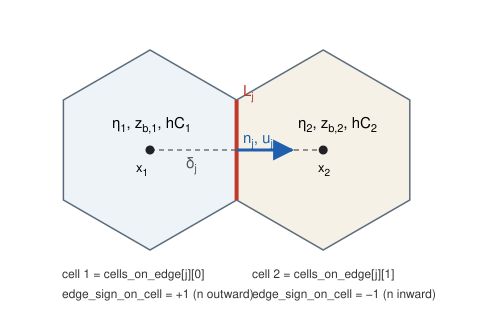

# 設計概要：支配方程式と離散化

この文書は、vormorph の支配方程式、ボロノイ C 格子上の離散式、1ステップの計算手順をまとめたものです。設計判断の理由は [ADR](adr/README.md) に記録しています。

> **状態**：v0.1.0 の時点では、ここに書いた離散式はまだ実装していません。実装の過程で式や手順を変えた場合は、この文書と ADR を同時に更新します。末尾の「[未決事項](#8-未決事項)」も参照してください。

## 目次

1. [対象と前提](#1-対象と前提)
2. [支配方程式](#2-支配方程式)
3. [格子と変数配置](#3-格子と変数配置)
4. [離散式](#4-離散式)
5. [1ステップの手順](#5-1ステップの手順)
6. [境界条件](#6-境界条件)
7. [時間刻みの制約](#7-時間刻みの制約)
8. [未決事項](#8-未決事項)

## 1. 対象と前提

- 対象は、堰や床止めを含む河道の平面二次元の流れと河床変動です。跳水や射流が局所的に生じます。
- 流れは水深平均の浅水流方程式で表し、静水圧を仮定します。
- 流砂は均一粒径の掃流砂と浮遊砂として扱います。混合粒径（平野の交換層モデル）は将来の拡張です。
- 単位はすべて SI 単位とし、浮動小数点数は `f64` を使います。

## 2. 支配方程式

### 2.1 流れ

水位を $\eta$、河床高を $z_b$、水深を $h = \eta - z_b$、水深平均流速を $\mathbf{u}$、単位幅流量を $\mathbf{q} = h\mathbf{u}$ とします。

連続式：

$$
\frac{\partial \eta}{\partial t} + \nabla\cdot(h\mathbf{u}) = 0
$$

運動量式（摩擦はマニング式）：

$$
\frac{\partial \mathbf{u}}{\partial t} + (\mathbf{u}\cdot\nabla)\mathbf{u} = -g\nabla\eta - \frac{g n^2 \lvert\mathbf{u}\rvert}{h^{4/3}}\mathbf{u}
$$

水平渦粘性は当面省略します。移流項は、跳水で運動量が保存されるように、次の保存形に書き直してから離散化します（Stelling & Duinmeijer, 2003）。

$$
(\mathbf{u}\cdot\nabla)\mathbf{u} = \frac{1}{h}\left[\nabla\cdot(\mathbf{q}\otimes\mathbf{u}) - \mathbf{u}\,\nabla\cdot\mathbf{q}\right]
$$

### 2.2 掃流砂

水中比重を $s = \rho_s/\rho - 1$、粒径を $d$ とし、無次元掃流力と無次元掃流砂量を次のように定義します。

$$
\tau_\ast = \frac{u_\ast^2}{s g d}, \qquad u_\ast^2 = \frac{g n^2 \lvert\mathbf{u}\rvert^2}{h^{1/3}}, \qquad q_b = \sqrt{s g d^3}\;\Phi(\tau_\ast)
$$

$\Phi$ は Meyer-Peter & Müller (1948) の式と芦田・道上 (1972) の式から、設定で選びます（$\tau_\ast \le \tau_{\ast c}$ では 0）。

$$
\Phi_{\mathrm{MPM}} = 8\left(\tau_\ast - \tau_{\ast c}\right)^{3/2}, \qquad \Phi_{\mathrm{AM}} = 17\,\tau_{\ast e}^{3/2}\left(1 - \frac{\tau_{\ast c}}{\tau_\ast}\right)\left(1 - \sqrt{\frac{\tau_{\ast c}}{\tau_\ast}}\right)
$$

$\tau_{\ast e}$ は有効掃流力です。当面は $\tau_{\ast e} = \tau_\ast$ とします。

掃流砂の向きは流速の向きを基本とし、河床勾配による補正を長谷川の式（長谷川, 1984。式の形は長谷川, 1983 と Nays2DH マニュアルで確認）で加えます。任意の方向 $\mathbf{n}$ の成分は次のとおりです。

$$
\mathbf{q}_b\cdot\mathbf{n} = q_b\left(\frac{\mathbf{u}_b\cdot\mathbf{n}}{\lvert\mathbf{u}_b\rvert} - \gamma\,\frac{\partial z_b}{\partial n}\right), \qquad \gamma = \sqrt{\frac{\tau_{\ast c}}{\mu_s \mu_k \tau_\ast}}
$$

$\mu_s$ は静止摩擦係数、$\mu_k$ は動摩擦係数です。$\mathbf{u}_b$ は河床近傍の流速で、二次流を考えない当面の実装では水深平均流速 $\mathbf{u}$ で代用します。

### 2.3 浮遊砂

水深平均濃度を $C$ とし、$hC$ を保存量とする移流拡散式を解きます。

$$
\frac{\partial (hC)}{\partial t} + \nabla\cdot(\mathbf{q}\,C) = \nabla\cdot(h\varepsilon\nabla C) + E - w_f c_b
$$

- $E$ は浮上量で、板倉・岸の式（Itakura & Kishi, 1980）または Garcia & Parker (1991) の式を使います。
- $w_f$ は沈降速度で、Rubey (1933) の式から求めます。
- $c_b$ は河床近傍の濃度で、$c_b = r\,C$ と表します。たとえば鉛直分布に指数分布を仮定すると $r = \beta/(1 - e^{-\beta})$、$\beta = 6 w_f/(\kappa u_\ast)$ です。$r$ の具体形は浮上量式に合わせて実装時に決めます。
- 水平拡散係数は $\varepsilon = \alpha\, u_\ast h$ とします。

### 2.4 河床（Exner 式）

空隙率を $\lambda$ とします。

$$
(1-\lambda)\frac{\partial z_b}{\partial t} + \nabla\cdot\mathbf{q}_b + E - w_f c_b = 0
$$

地形変化の時間スケールを縮めるため、河床の更新量に MORFAC $M$ を掛けます（流れと浮遊砂の式には掛けません）。

## 3. 格子と変数配置

ボロノイ格子では、隣り合う母点を結ぶ線分と、両者を隔てる辺が直交します。この性質を使い、変数を C 格子（スタガード）に配置します。

- セル中心（母点）：水位 $\eta_i$、河床高 $z_{b,i}$、浮遊砂 $(hC)_i$
- 辺：法線流速 $u_j$

| 記号 | 意味 | コード上の名前 |
|---|---|---|
| $i$, $j$ | セル番号、辺番号 | |
| $1(j)$, $2(j)$ | 辺 $j$ を挟む2つのセル | `cells_on_edge[j][0]`, `[1]` |
| $k(i,j)$ | 辺 $j$ を挟んでセル $i$ の隣にあるセル | `cells_on_cell` |
| $\partial i$ | セル $i$ を囲む辺の集合 | `edges_on_cell` |
| $s_{i,j}$ | 辺 $j$ の法線がセル $i$ から外向きなら $+1$、内向きなら $-1$ | `edge_sign_on_cell` |
| $A_i$ | セル面積 | `area_cell` |
| $L_j$ | 辺の長さ | `dv_edge` |
| $\delta_j$ | 母点間の距離 | `dc_edge` |
| $\mathbf{n}_j$ | 辺の単位法線（$1(j)$ から $2(j)$ へ向く） | `normal_edge` |
| $\mathbf{x}_i$, $\mathbf{x}_j$ | 母点の座標、辺の中点の座標 | `x_cell`, `x_edge` など |
| $H_j$ | 辺の水深 | |
| $\theta$ | θ 法の重み（0.55〜0.6） | |

符号の規約は次のとおりです。

- $u_j > 0$ は $1(j)$ から $2(j)$ へ向かう流れを表します。
- セル $i$ から外へ出る流量は $\sum_{j\in\partial i} s_{i,j} L_j H_j u_j$ です。
- 境界辺では $2(j)$ を領域外（`NONE = usize::MAX`）とし、法線は領域の外を向きます。

MPAS-Ocean の `edgeSignOnCell` はこれと逆符号（`cellsOnEdge(1)` 側を $-1$）なので、MPAS 形式のデータを読み込むときは符号を反転します。

## 4. 離散式

### 4.1 運動量式（辺）

移流を陽的に、水位勾配を θ 法で、摩擦を陰的に扱います（Casulli & Walters, 2000）。

$$
u_j^{n+1} = F u_j^n - \frac{g\Delta t}{\delta_j}\left[\theta\left(\eta_{2(j)}^{n+1} - \eta_{1(j)}^{n+1}\right) + (1-\theta)\left(\eta_{2(j)}^{n} - \eta_{1(j)}^{n}\right)\right] - \Delta t\,\gamma_j\,u_j^{n+1}
$$

$F u_j^n$ は移流を評価した後の流速（4.4節）です。$\gamma_j$ は摩擦係数で、時刻 $n$ の値で線形化します。

$$
\gamma_j = \frac{g n^2 \lvert\mathbf{u}\rvert_j^n}{\left(H_j^n\right)^{4/3}}
$$

$u_j^{n+1}$ について解くと、次の形になります。

$$
u_j^{n+1} = G_j - \frac{\theta g \Delta t}{\delta_j\left(1 + \Delta t\,\gamma_j\right)}\left(\eta_{2(j)}^{n+1} - \eta_{1(j)}^{n+1}\right)
$$

$$
G_j = \frac{1}{1 + \Delta t\,\gamma_j}\left[F u_j^n - (1-\theta)\frac{g\Delta t}{\delta_j}\left(\eta_{2(j)}^{n} - \eta_{1(j)}^{n}\right)\right]
$$

辺の水深 $H_j^n$ は、風上側のセルの水位から辺の河床高を引いた値とします（Stelling & Duinmeijer, 2003）。

$$
H_j^n = \max\left(\eta_{\mathrm{up}(j)}^n - z_{b,j},\ 0\right), \qquad z_{b,j} = \max\left(z_{b,1(j)},\ z_{b,2(j)}\right)
$$

辺の河床高に両側の高い方を使うと、床止めのような段差で、天端を越える流れの水深を正しく表せます。$H_j^n$ が閾値 `dry_depth` 未満の辺は乾いているとみなし、$u_j^{n+1} = 0$ とします。

### 4.2 連続式（セル）

セル $i$ の水の体積を $V_i(\eta_i)$ とします。セル内の河床高が一定なら、次のようになります。

$$
V_i(\eta_i) = A_i \max\left(\eta_i - z_{b,i},\ 0\right)
$$

連続式は、辺の流量に θ 平均の流速を使って次のように離散化します。

$$
V_i\left(\eta_i^{n+1}\right) = V_i\left(\eta_i^{n}\right) - \Delta t\sum_{j\in\partial i} s_{i,j}\, L_j\, H_j^n\left[\theta\, u_j^{n+1} + (1-\theta)\, u_j^n\right] + \Delta t\, Q_i
$$

$Q_i$ は上流端の流量境界からの流入です。この離散式はセルごとに体積を厳密に保存し、水位方程式の解の精度（Newton 法と PCG の収束判定値）の範囲で全体の質量も保存されます。

### 4.3 水位の連立方程式

4.1節の $u_j^{n+1}$ を4.2節に代入します。$s_{i,j}\left(\eta_{2(j)} - \eta_{1(j)}\right) = \eta_{k(i,j)} - \eta_i$ を使うと、水位について次の連立方程式が得られます。

$$
V_i\left(\eta_i^{n+1}\right) + \sum_{j\in\partial i} w_j\left(\eta_i^{n+1} - \eta_{k(i,j)}^{n+1}\right) = b_i, \qquad w_j = \frac{g\,\theta^2 \Delta t^2\, L_j\, H_j^n}{\delta_j\left(1 + \Delta t\,\gamma_j\right)}
$$

$$
b_i = V_i\left(\eta_i^{n}\right) - \Delta t\sum_{j\in\partial i} s_{i,j}\, L_j\, H_j^n\left[\theta\, G_j + (1-\theta)\, u_j^n\right] + \Delta t\, Q_i
$$

ベクトルで書くと $\mathbf{V}(\boldsymbol{\eta}) + \mathsf{T}\boldsymbol{\eta} = \mathbf{b}$ です。$\mathsf{T}$ は重み $w_j \ge 0$ を持つグラフラプラシアン型の対称行列で、半正定値です。

$\mathbf{V}$ は wet/dry の境目（$\eta_i = z_{b,i}$）で折れる区分線形の関数なので、Newton 法で解きます（Casulli, 2009; Casulli & Zanolli, 2012）。

$$
\left[\mathsf{P}^{(m)} + \mathsf{T}\right]\boldsymbol{\eta}^{(m+1)} = \mathbf{b} - \mathbf{V}\left(\boldsymbol{\eta}^{(m)}\right) + \mathsf{P}^{(m)}\boldsymbol{\eta}^{(m)}
$$

- $\mathsf{P}^{(m)}$ は $\mathbf{V}$ の微分で、wet セル（$\eta_i^{(m)} > z_{b,i}$）では $A_i$、dry セルでは 0 の対角行列です。
- $\mathsf{P} + \mathsf{T}$ は、各連結成分に wet セルか水位境界が1つでもあれば対称正定値です。各段の線形系は、行列を組み立てずに前処理付き共役勾配法（Jacobi 前処理）で解きます。
- 行列とベクトルの積はセル単位のループで計算し、各セルが自分の成分だけを書き込むようにします。将来 rayon で並列化するときに、書き込みの競合が起きないようにするためです。
- Newton 反復の初期値の選び方と収束の条件は、Casulli (2009) と Casulli & Zanolli (2012) に従います（実装時に確認）。

$\boldsymbol{\eta}^{n+1}$ が求まったら、4.1節の式で $u_j^{n+1}$ を更新します。

### 4.4 移流（保存型風上差分）

移流は陽的な保存型風上差分で評価します（Stelling & Duinmeijer, 2003; Kramer & Stelling, 2008）。まず、セル $i$ の移流加速度を2.1節の保存形に基づいて求めます。流出側の辺では $\mathbf{u}_{\mathrm{up}} = \mathbf{u}_i$ となって寄与が消えるため、流入側の辺だけが残ります。

$$
\mathbf{a}_i = \frac{1}{V_i}\sum_{j\in\partial i,\ s_{i,j} q_j < 0} s_{i,j}\, L_j\, q_j\left(\mathbf{u}_{k(i,j)} - \mathbf{u}_i\right), \qquad q_j = H_j^n u_j^n
$$

$\mathbf{u}_i$ は4.5節の Perot 法で再構成したセル中心の流速です。辺の移流加速度は、両側のセルの値を重み付き平均して法線成分をとります。

$$
F u_j^n = u_j^n - \Delta t\left[\alpha_j\,\mathbf{a}_{1(j)} + \left(1 - \alpha_j\right)\mathbf{a}_{2(j)}\right]\cdot\mathbf{n}_j
$$

- 重み $\alpha_j$（距離による重みか体積による重みか）は実装時に決め、ADR に記録します。
- 上の式は1次精度の風上差分です。2次精度への拡張（制限関数付き）も実装時に検討します。
- 加速流（堰の天端へ向かう流れなど）では、エネルギー水頭を保存する形に切り替えることを予定しています。切り替えの判定方法は未決事項です。

### 4.5 流速の再構成（Perot 法）

セル中心の流速ベクトルを、辺の法線流速から次の式で再構成します（Perot, 2000）。

$$
\mathbf{u}_i = \frac{1}{A_i}\sum_{j\in\partial i} s_{i,j}\, L_j\, u_j\left(\mathbf{x}_j - \mathbf{x}_i\right)
$$

ここで $\mathbf{x}_j$ は辺の中点です。一様流 $\mathbf{u}$ に対しては、発散定理から次の式が成り立ちます。

$$
\oint_{\partial\Omega_i} (\mathbf{u}\cdot\mathbf{n})\left(\mathbf{x} - \mathbf{x}_i\right) ds = \int_{\Omega_i} \nabla\cdot\left[\mathbf{u}\otimes\left(\mathbf{x} - \mathbf{x}_i\right)\right] dA = A_i\,\mathbf{u}
$$

辺の上では被積分関数が $\mathbf{x}$ の1次式です。したがって辺の中点で評価した上の和はこの線積分に一致し、再構成は一様流で厳密になります（検証ケース V02）。

### 4.6 掃流砂（辺の法線成分）

掃流砂量は、辺 $j$ の法線成分を直接評価します。

$$
q_{b,j} = \sqrt{s g d^3}\;\Phi\left(\tau_{\ast j}\right)\left[\frac{u_j}{\lvert\mathbf{u}\rvert_j} - \gamma_j\,\frac{z_{b,2(j)} - z_{b,1(j)}}{\delta_j}\right]
$$

- $\lvert\mathbf{u}\rvert_j$ は、法線成分 $u_j$ と、両側のセル中心流速から補間した接線成分とを合わせた大きさです。
- 母点を結ぶ線分が辺に直交するので、法線方向の河床勾配は2点差分で求まります。
- 壁の辺では $q_{b,j} = 0$ とします。

**非侵食層（床止め）**：セル $i$ から1ステップで流出する土砂量 $O_i$ と、非侵食層より上にある土砂量 $S_i$ を比べます。

$$
O_i = M \Delta t \sum_{j\in\partial i,\ s_{i,j} q_{b,j} > 0} s_{i,j}\, L_j\, q_{b,j}, \qquad S_i = (1-\lambda)\, A_i \max\left(z_{b,i} - z_{ne,i},\ 0\right)
$$

$O_i > S_i$ のときは、セル $i$ から流出する辺の流砂量をすべて $S_i/O_i$ 倍に縮めます。各辺の流砂は、上流側のちょうど1つのセルにとってだけ流出になるので、縮める倍率は辺ごとに一意に決まります。

### 4.7 浮遊砂

浮遊砂の移流には、連続式と同じ θ 平均の単位幅流量 $q_j^{\theta} = H_j^n\left[\theta\, u_j^{n+1} + (1-\theta)\, u_j^n\right]$ を使います。

$$
A_i\,(hC)_i^{\ast} = A_i\,(hC)_i^{n} - \Delta t\sum_{j\in\partial i} s_{i,j}\, L_j\, q_j^{\theta}\, C_{\mathrm{up}(j)}^n + \Delta t\sum_{j\in\partial i} L_j\,\frac{(h\varepsilon)_j}{\delta_j}\left(C_{k(i,j)}^n - C_i^n\right) + \Delta t\, A_i\, E_i
$$

沈降は陰的に扱い、$C_i^{n+1} = (hC)_i^{n+1} / h_i^{n+1}$ を使って次のように解きます。

$$
(hC)_i^{n+1} = \frac{(hC)_i^{\ast}}{1 + \Delta t\, w_f\, r_i / h_i^{n+1}}
$$

- 連続式と同じ流量を使うと、濃度が一様な状態（$C$ = 一定）が移流で崩れません。上の式に $C$ = 一定を代入すると、移流の項が連続式の体積変化と打ち消し合います。
- 水深が `min_depth` 未満のセルでは $E_i = 0$ として浮上を止めます。浅いセルで濃度が過大になるのを防ぐためです。
- 移流は陽的な風上差分なので、$hC \ge 0$ を保つには7章の Courant 条件が必要です。

### 4.8 河床の更新

$$
(1-\lambda)\, A_i\left(z_{b,i}^{n+1} - z_{b,i}^{n}\right) = -M\Delta t\left[\sum_{j\in\partial i} s_{i,j}\, L_j\, q_{b,j} + A_i\left(E_i - w_f\, r_i\, C_i^{n+1}\right)\right]
$$

更新の後、次の処理を行います。

1. **安息角補正**：$\lvert z_{b,2(j)} - z_{b,1(j)}\rvert / \delta_j > \tan\phi$ となる辺では、勾配がちょうど $\tan\phi$ になるように、体積を保ったまま高い側から低い側へ土砂を移します。セル単位のループで、各辺の交換量を両側のセルが同じ式で計算し（Jacobi 型）、勾配が収まるまで反復します。
2. **水位の調整**：湛水しているセルでは水位 $\eta_i$ を保ち、水深が河床の変化分だけ変わります。乾いたセルでは $\eta_i = z_{b,i}$ とします。湛水セルで水位を保つと水の体積が $-\sum_i A_i \Delta z_{b,i}$ だけ変わるので、この量を質量収支に記録します（`MassBalance::bed_exchange`）。

## 5. 1ステップの手順

| 段階 | 処理 | 主なモジュール |
|---|---|---|
| 流れ 1 | 辺の水深 $H_j^n$ と wet/dry の判定 | `hydro::edge_depths` |
| 流れ 2 | Perot 法でセル中心の流速 $\mathbf{u}_i^n$ を再構成 | `hydro::reconstruct_cell_velocity` |
| 流れ 3 | 移流を陽的に評価して $F u_j^n$ を求める | `hydro::advection` |
| 流れ 4 | 摩擦係数 $\gamma_j$、$G_j$、重み $w_j$、右辺 $b_i$ を組み立てる | `hydro::HydroSolver::step` |
| 流れ 5 | Newton 法＋行列フリー PCG で $\boldsymbol{\eta}^{n+1}$ を求める | `hydro::WaterLevelOperator`, `linsolve::pcg` |
| 流れ 6 | $u_j^{n+1}$ を更新し、θ 平均流量 $q_j^{\theta}$ を保存する | `hydro::HydroSolver::step` |
| 流砂 7 | 辺の掃流砂量 $q_{b,j}$（勾配補正、非侵食層の頭打ち） | `sediment::SedimentSolver::compute_bedload` |
| 流砂 8 | 浮遊砂 $(hC)^{n+1}$（沈降は陰的） | `sediment::SedimentSolver::step_suspended` |
| 流砂 9 | Exner 式（MORFAC）、安息角補正、水位の調整 | `sediment::SedimentSolver::update_bed` |
| 収支 10 | 水と土砂の質量収支を更新し、出力時刻なら VTK を書く | `model`, `io` |

流砂の段階（7〜9）は、時刻が `time.morphology_start` を過ぎてから行います。

## 6. 境界条件

| 境界 | 流れ | 流砂 |
|---|---|---|
| 壁 | $u_j = 0$。辺を水位方程式から除く | 掃流砂・拡散フラックスとも 0 |
| 上流端（流量） | 流量 $Q$ を境界辺に通水能 $K_j = L_j H_j^{5/3}/n$ に比例して配分し、既知の流入 $Q_i$ として右辺に入れる | 平衡給砂（境界セルの流砂量と同じ量）、または給砂なし |
| 下流端（水位固定） | 母点を辺に関して鏡映した点の水位を既知の値 $\eta_b$ とし、$w_j\eta_b$ を右辺へ移す。$\delta_j$ には鏡映点までの距離を使う | 風上側の値で自由に流出 |
| 下流端（水深一定） | 境界セルの河床高に一定の水深を加えた値を $\eta_b$ とする | 同上 |

## 7. 時間刻みの制約

- **重力波**：水位勾配を陰的に扱うので、重力波の Courant 条件 $(\lvert\mathbf{u}\rvert + \sqrt{gh})\Delta t / \Delta x \le 1$ には制約されません。
- **移流**：移流は陽的な風上差分なので、セルから1ステップで流出する体積がセルの体積を超えないことが必要です。おおよそ $\lvert\mathbf{u}\rvert\Delta t/\Delta x \lesssim 1$ です。

$$
\Delta t \sum_{j\in\partial i,\ s_{i,j} q_j > 0} s_{i,j}\, L_j\, q_j \le V_i
$$

- **河床**：MORFAC を掛けた河床の変化が、1ステップで隣のセルとの高低差を逆転させない程度に抑えます。

半陰解法で得をする度合いは、フルード数が小さいほど大きくなります。たとえば `examples/sill.toml`（$Fr \approx 0.58$）では、重力波と移流の Courant 条件の差は約 2.7 倍にとどまります。この例題では、時間刻みの利点よりも wet/dry と急変流を安定に扱えることが主な目的です。

## 8. 未決事項

実装の過程で決め、結果を ADR に記録します。

- 辺の水深 $H_j$ の定義の細部（wet/dry の境界付近、$u_j = 0$ のときの扱い）
- 移流の重み $\alpha_j$、2次精度化と制限関数
- 運動量保存形とエネルギー水頭保存形を切り替える判定方法
- セル内の河床の起伏（サブグリッド地形、Casulli, 2009）を体積関数に入れるかどうか
- 二次流による掃流砂の向きの補正（湾曲水路の検証ケース V10 で必要になる）
- 外部格子のファイル形式と境界の種類の指定方法（JIGSAW の出力を想定）
- 混合粒径（平野, 1971 の交換層モデル）
- 水平渦粘性の要否

## 参考文献

書誌情報と入手方法は [docs/references.md](../references.md) にまとめています。
