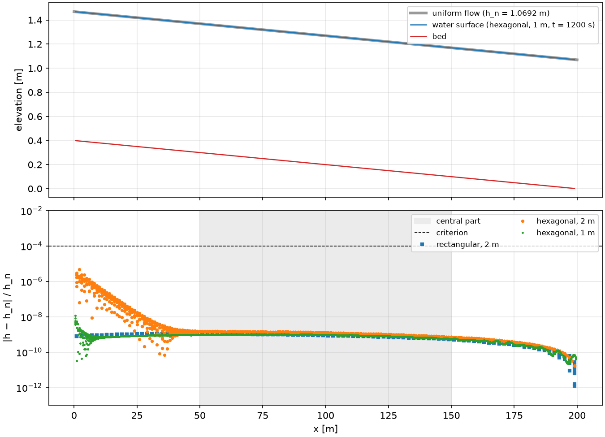
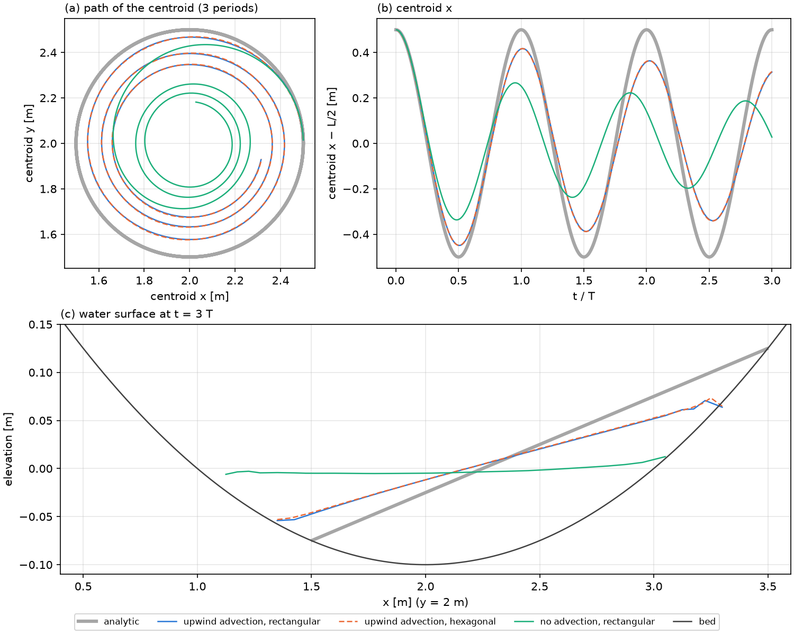
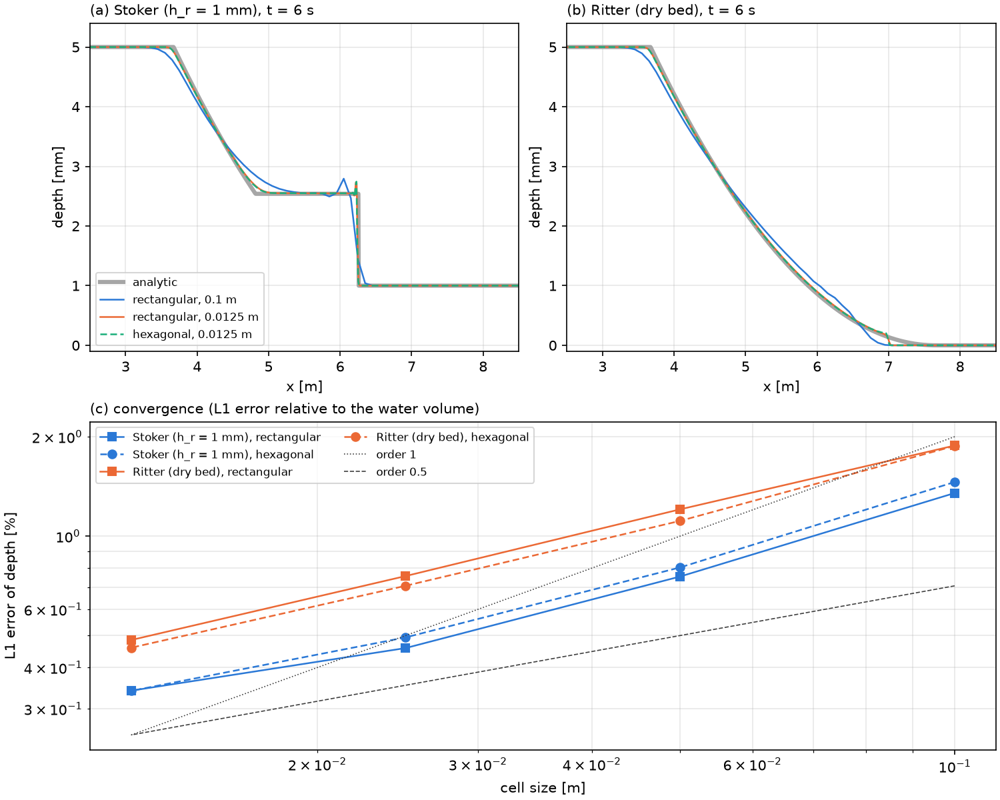
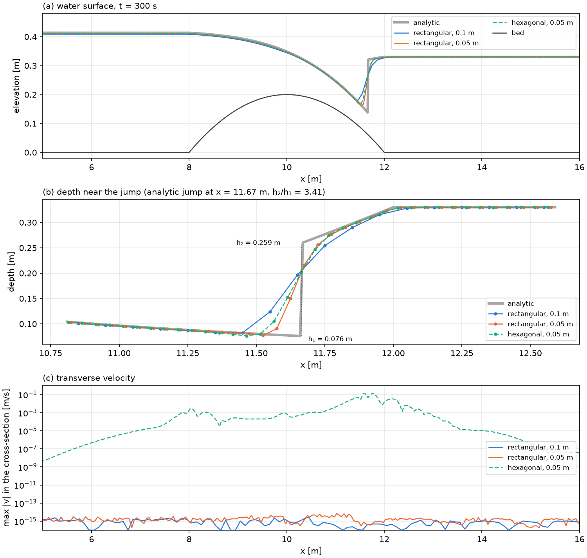
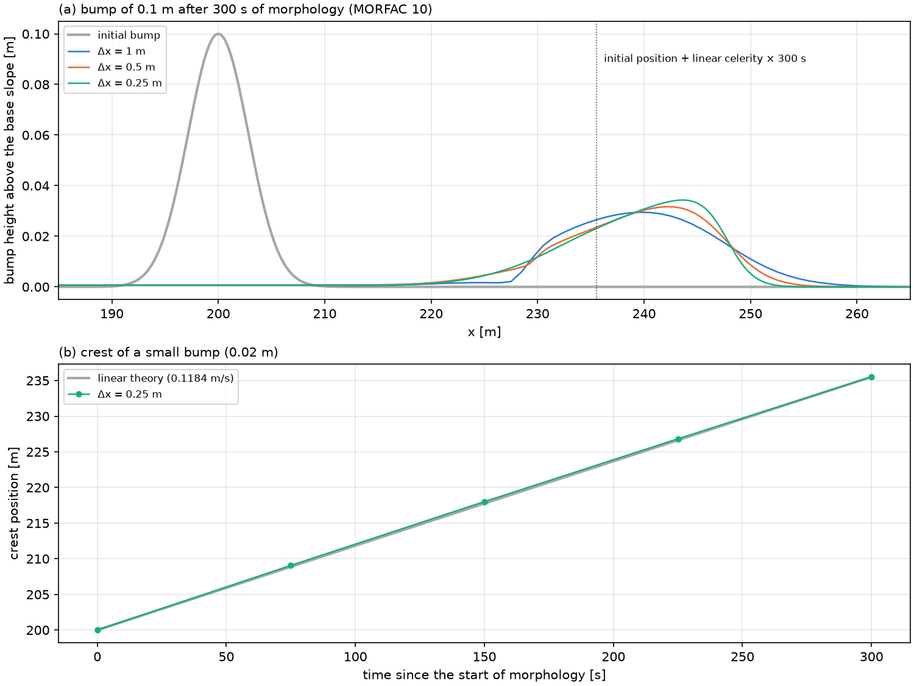
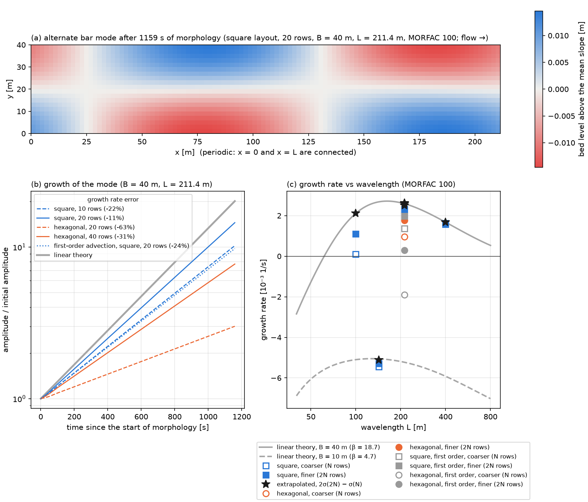

# 検証計画と結果

この文書は、vormorph の検証ケースの一覧と、その結果の記録先です。

- 各ケースは `tests/verification.rs` のテスト関数と 1 対 1 に対応します。
- 未実装のケースには `#[ignore]` を付けています。実装したら `#[ignore]` を外し、この文書と README の状態欄を更新します。
- 検証テストが通らない変更はマージしません（[CLAUDE.md](../CLAUDE.md) の開発方針）。

```bash
cargo test                              # 実装済みのケースだけ
cargo test -- --ignored                 # 未実装のケースも実行（現状は todo!() で失敗する）
cargo test --test verification v06      # 1ケースだけ
```

## 一覧

状態の記号：✅ 実装済み（テストが通る）／ 🚧 進行中 ／ 📋 予定

| ID | ケース | 確認すること | 合格基準（案） | テスト関数 | 状態 |
|---|---|---|---|---|---|
| V01 | 格子幾何 | 総面積、直交誤差、各セルが閉じていること（周期的な水路を含む） | 面積の相対誤差・直交誤差・閉合誤差がいずれも $10^{-12}$ 以下（確定） | `v01_mesh_geometry` | ✅ |
| V02 | Perot 再構成 | 一様流で厳密に一致すること（周期的な水路を含む） | 全セル（境界セルを含む）で誤差 $10^{-12}$ m/s 以下（確定） | `v02_perot_uniform_flow` | ✅ |
| V03 | 静水保持（干出する島を含む） | 流速が発生しないこと（well-balanced） | 1000 ステップ後に流速の最大値 $10^{-12}$ m/s 以下、湿潤セルの水位の変化 $10^{-12}$ m 以下、乾燥セルは乾燥のまま（確定） | `v03_lake_at_rest_with_island` | ✅ |
| V04 | 閉鎖水域の振動 | 質量保存、負の水深が出ないこと、Thacker の解析解との比較 | 体積の相対誤差 $10^{-10}$ 以下、全ステップで全セル（乾いたセルを含む）の連続式の残差が Newton 法の判定値以下、水塊の重心の誤差が 1周期後 0.12 m・3周期後 0.25 m 以下、水深の L1 誤差が 1周期後 20%・3周期後 40% 以下（確定） | `v04_closed_basin_oscillation` | ✅ |
| V05 | ダム破壊 | Ritter / Stoker の解析解との比較 | 水深の L1 誤差が格子を細かくするたびに減り、平均の収束次数 0.5 以上、最も細かい格子で Stoker 0.5%・Ritter 0.7% 以下、Stoker の衝撃波の位置の誤差が格子幅の 2 倍以下、Ritter の先端の遅れが格子を細かくするたびに減る（確定） | `v05_dam_break` | ✅ |
| V06 | 等流 | マニング式の等流水深に一致すること。周期境界では、静止状態から体積力で加速した流れが等流になること | 中央部の水深の相対誤差 $10^{-4}$ 以内。周期境界では流速の相対誤差 $10^{-4}$ 以内、水深の相対誤差 $10^{-10}$ 以内（確定） | `v06_uniform_flow` | ✅ |
| V07 | 跳水 | 共役水深と跳水位置 | こぶを越える流れ（正方形配置・六角形配置）で、定常、跳水の位置の誤差が格子幅の 2 倍以下、跳水の直前と直後の水深の誤差 2% 以下、それ以外の水深の誤差 4% 以下（正方形配置では格子を細かくすると減る）（確定） | `v07_hydraulic_jump` | ✅ |
| V08 | トレンチ移動 | 浮遊砂の検証 | トレンチの移動速度と形状（比較対象は実装時に選定） | `v08_trench_migration` | 📋 |
| V09 | 交互砂州 | 線形安定解析の成長率と移動速度（周期境界。1次の形と、2次の移流＋予測子・修正子の形）。有限振幅の波長と波高（実験との比較）は未実装 | 横断方向 N 行と 2N 行の成長率の誤差の比が 0.4〜0.6（1次の収束）、Richardson 外挿した成長率の誤差が正方形配置で 5%・六角形配置で 10% 以下、細かい格子の移動速度の誤差が正方形配置で 2%・六角形配置で 5% 以下、発生の境より狭い水路で減衰すること（線形の比較は確定） | `v09_alternate_bars` | 🚧 |
| V10 | 湾曲水路の河床変動 | 外岸側の洗掘 | 横断形状を既往の実験と比較 | `v10_bend_scour` | 📋 |
| V11 | 河床のこぶの移動 | 移動速度と、格子を細かくしたときの縦断形の収束 | 格子幅 1・0.5・0.25 m で縦断形の差（L1）が格子を細かくするたびに減り、細かい2つの差がこぶの初期の体積の 15% 以下。高さ 0.02 m のこぶの山の移動速度が線形理論の値の 5% 以内。土砂の収支の誤差が $10^{-10}$ 以下（確定） | `v11_bump_migration` | ✅ |
| V12 | 平衡河床の保持 | 等流に平衡給砂を与えると河床が変わらないこと | 正方形配置と格子生成ツールの格子で、全セルの河床の変化が $10^{-12}$ m 以下。六角形配置で、中央部の変化が $10^{-3}$ m 以下、格子幅 2 m → 1 m で 1/4 以下。一定の給砂量（六角形配置 2 m）でも中央部 $10^{-3}$ m 以下、上流端に接するセル $10^{-2}$ m 以下。周期境界では、六角形配置でも全セル $10^{-12}$ m 以下。土砂と水の収支の誤差が $10^{-10}$ 以下（確定） | `v12_equilibrium_bed` | ✅ |

合格基準は現時点の案です。実装時に根拠（丸め誤差の見積もり、反復解法の収束判定値など）とともに確定し、変更した場合はこの表を更新します。

## 各ケースの設定

### V01 格子幾何

- 延長 200 m・幅 20 m の直線水路の格子を、格子幅 2 m の正方形配置と六角形配置で生成します（`mesh::channel::build`）。
  - 正方形配置：100 × 10 セル
  - 六角形配置：行の間隔 $20/12 \approx 1.67$ m の 12 行で、偶数行に 100 セル、奇数行に 99 セル（計 1194 セル）。上下流端に接するセルは、ボロノイ図を水路の矩形で切り取った多角形になります
- 次の3点を確かめます（`Mesh::check_geometry`）。
  - 全セル面積の和が水路の面積に一致すること
  - 内部の辺で、母点間ベクトルと辺の向きが直交していること（$\lvert\cos\rvert$ の最大値）
  - 各セルで $\sum_k s_{i,k} L_k \mathbf{n}_k = \mathbf{0}$（セルが閉じている）が成り立つこと
- 上流端と下流端をつないだ周期的な水路（`mesh::channel::build_periodic`、[ADR-0014](design/adr/0014-periodic-channel.md)）でも、同じ寸法・格子幅で確かめます。継ぎ目の辺の直交誤差は、平行移動した母点との間で測ります。六角形配置の周期的な水路は、どの行も 100 セルで、継ぎ目のセルも内部と同じ六角形です（計 1200 セル）。
- 合格基準の根拠：座標の大きさは最大 200 m なので、頂点の座標の丸め誤差は $200 \times 2.2\times10^{-16} \approx 4\times10^{-14}$ m 程度です。最も短い辺（約 0.11 m）でも、直交誤差は $10^{-12}$ を下回ります。$10^{-12}$ を超えたら、丸め誤差ではなく幾何の誤り（頂点の取り違えや母点の位置の誤り）とみなします。

### V02 Perot 再構成

- 一様流 $\mathbf{u} = (0.7, -0.3)$ m/s の法線成分を全辺に与えます。
- 再構成したセル中心の流速が、丸め誤差の範囲で元の流速に一致することを確かめます。
- 境界セルも含めます。これが成り立つには、辺の中点を使う必要があります（[overview.md](design/overview.md) の第4.5節）。
- 格子は、V01 と同じ直線水路の2つの配置とその周期的な水路（継ぎ目の辺の中点は、セルの側の座標で使う）に加え、格子生成ツールで作った島のある池の格子（`tests/data/island_coarse.mesh.toml`、125 セル）を使います。母点がセルの重心と一致しない、不規則なボロノイ格子でも厳密になることを確かめるためです。

### V03 静水保持（干出する島を含む）

- 四辺を壁とした矩形水域（40 m × 20 m、格子幅 1 m、正方形配置と六角形配置）の中央に、水面（$\eta_0$ = 1 m）から突き出るガウス型の島（高さ 2 m、標準偏差 3 m）を置きます。河床には起伏 $0.2\sin(0.3x)\cos(0.2y)$ m も加え、湿潤セルの河床高をばらつかせます。
- 格子生成ツールで作った島のある池の格子（`tests/data/island_coarse.mesh.toml`、穴あり）でも、河床にガウス型の島（中心 (12, 15) m、標準偏差 4 m）と同じ起伏を与えて確かめます。
- 水位一定・流速 0 から、$\Delta t$ = 1 s で 1000 ステップ進めます（摩擦 $n$ = 0.03）。流速が生じないこと、湿潤セルの水位が変わらないこと、乾燥セルが乾燥のまま（$\eta = z_b$）であることを確かめます。
- wet/dry の境界で、辺の水深の定義によって偽の流れが生じないことを確かめるのが目的です（[ADR-0006](design/adr/0006-wet-dry-and-newton.md)）。
- 合格基準の根拠：離散式の上では、静水は丸め誤差も含めて厳密に保たれます（湿潤セルどうしの辺は水位差が厳密に 0、乾燥セルと接する辺は水深が 0）。$10^{-12}$ を超えたら、丸め誤差ではなく定義の誤りとみなします。

### V04 閉鎖水域の振動

- 放物面の容器 $z_b = -h_0(1 - r^2/a^2)$ の中で、平面の水面が回りながら振動する Thacker (1981) の解析解を使います。条件は SWASHES（Delestre et al., 2013）の "planar surface in a paraboloid" と同じで、$a$ = 1 m、$h_0$ = 0.1 m、$\eta$ = 0.5 m、4 m × 4 m の領域、3周期（周期 $T = 2\pi a/\sqrt{2gh_0}$ ≈ 4.49 s）、摩擦なしです。
  - 水塊は半径 $a$ の放物面の形のまま、中心から 0.5 m 離れた円の上を回ります。流速は空間的に一様（大きさ $\eta\omega$ ≈ 0.70 m/s）で、汀線が動き続けます。
- 格子は格子幅 0.05 m の正方形配置と六角形配置、時間刻みは $T/200$ です。初期条件は $t = 0$ の解析解（湿潤セルどうしの辺に流速の法線成分を与える）です。
- 次の点を確かめます。
  - 水の体積の相対誤差が $10^{-10}$ 以下であること
  - 全ステップで、乾いたセルを含む全セルの連続式の残差 $\lvert V_i^{n+1} - V_i^n + \Delta t \sum_j s_{i,j} L_j q_j^\theta\rvert / A_i$ が Newton 法の判定値（$10^{-10}$ m）以下であること
  - 水塊の重心（$\sum_i V_i \mathbf{x}_i / \sum_i V_i$）と解析解の重心との距離が、1周期後に 0.12 m 以下、3周期後に 0.25 m 以下であること
  - 水深の L1 誤差 $\sum_i A_i \lvert h_i - h(\mathbf{x}_i, t)\rvert / \sum_i A_i h(\mathbf{x}_i, t)$ が、1周期後に 20% 以下、3周期後に 40% 以下であること
- 「水深が負にならないこと」の確かめ方：体積関数 $V_i = A_i\max(\eta_i - z_{b,i}, 0)$ の定義から、水深は常に 0 以上です。気をつけるべきなのは、負の体積を避けるために水を作り出していないかどうかです。乾いたセルの連続式の残差が判定値以下であれば、そのような水の生成はありません（[ADR-0006](design/adr/0006-wet-dry-and-newton.md)）。
- 合格基準の根拠：修正量の形の Newton 法では、最終的な残差は反復解法の判定値よりずっと小さくなります。体積の誤差 $10^{-10}$ は、丸め誤差の積み重ね（実測で $10^{-13}$ 程度）より十分大きく、Newton 法が判定値ぎりぎりで止まった場合（1ステップあたり最大で、判定値 × 総面積 / 体積 ≈ $10^{-8}$）は検出できる水準です。
- 解析解との比較の基準の根拠：移流がない場合（1周期後に重心の誤差 0.27 m、L1 誤差 46%）を確実に検出でき、移流がある場合の実測値（1周期後に 0.091 m、16%）に約 3 割の余裕を持たせた水準です。残る誤差は1次精度の離散化の誤差で、格子幅を半分にすると約 0.6 倍になります（下の結果）。
- VTK を書き出すときは（`VORMORPH_VERIFICATION_OUTPUT`）、図のために移流なし（`[hydro] advection = "none"`）の計算も行い、各ケースの水塊の重心の時系列を `centroid.csv` に書きます。

### V05 ダム破壊

- 下流が湛水している場合は Stoker (1957)、下流が乾燥している場合は Ritter (1892) の解析解と比べます。条件は SWASHES（Delestre et al., 2013）の §4.1.1, §4.1.2 と同じで、延長 10 m の平らな水路、ダムの位置 $x_0$ = 5 m、上流側の水深 $h_l$ = 5 mm、下流側の水深 $h_r$ = 1 mm（Stoker）／0（Ritter）、摩擦なし、比べる時刻は $t$ = 6 s です。
  - Stoker の解：中間の水深 $h_m$ = 2.54 mm、衝撃波の位置 6.26 m。
  - Ritter の解：先端の位置 $x_0 + 2\sqrt{gh_l}\,t$ = 7.66 m。
- 1次元の流れを、幅 0.2 m・側壁が滑り条件の水路で解きます。格子幅は 0.1、0.05、0.025、0.0125 m、配置は正方形と六角形です。
- 時間刻みは、最大の流速 $2\sqrt{gh_l}$（Ritter の先端）に対するクーラン数が 0.5 以下で、6 s をちょうど割り切る値です。水深が mm の単位なので、`dry_depth` は $10^{-6}$ m にします。
- 次を確かめます。
  - 水深の L1 誤差 $\sum_i A_i \lvert h_i - h(x_i)\rvert / \sum_i A_i h(x_i)$ が格子を細かくするたびに減り、0.1 m から 0.0125 m までの平均の収束次数が 0.5 以上であること
  - 0.0125 m での L1 誤差が、Stoker で 0.5% 以下、Ritter で 0.7% 以下であること
  - Stoker：衝撃波の位置の誤差が、どの格子でも格子幅の 2 倍以下であること。位置は質量から求めます。中間の一様な区間の中ほど $x_m$ より下流の水の量 $\int (h - h_r)\,dx$ を $(h_m - h_r)$ で割り、$x_m$ に足します
  - Ritter：先端（水深が $10^{-4}$ m の位置。解析解では 7.09 m）の遅れが、格子を細かくするたびに減ること
- 合格基準の根拠：
  - 収束次数：不連続（衝撃波・乾いた河床の先端）を含む解では、1次精度のスキームの L1 誤差の収束次数は 0.5〜1 です。下限の 0.5 を基準にします。
  - 最も細かい格子での L1 誤差の上限：実測値（Stoker 0.34%、Ritter 0.48%）に約 4 割の余裕を持たせました。
  - 衝撃波の位置：衝撃波は 2〜3 セルの幅でなまるので、格子幅の 2 倍以内を基準にします。

### V06 等流

- 直線水路（延長 200 m、幅 20 m、勾配 $I$ = 1/500、側壁は滑り条件）に流量 40 m³/s を与え、粗度係数 $n$ = 0.025 とします。`examples/sill.toml` の床止めがない場合と同じ条件で、等流水深は $h_n = (n q / \sqrt{I})^{3/5}$ = 1.069235 m です。
- 下流端は水位境界で、水位を等流水位（下流端の河床高 0 m + $h_n$）に固定します。水深一定の境界では、境界辺の河床高の代わりに内側のセルの河床高を使うので、勾配のある水路では $O(I\delta_j/2)$ の誤差が残ります（[ADR-0007](design/adr/0007-open-boundaries.md)）。
- 初期条件は、一様な水深 $h_n$、流速 0 です。1200 s 進め、中央部（50 m ≤ $x$ ≤ 150 m）の水深と $h_n$ の相対誤差の最大値を確かめます。
- 格子は、格子幅 2 m の正方形配置・六角形配置と、1 m の六角形配置です。1 m の六角形配置は `examples/sill.toml` と同じ格子で、上下流端の奇数行の端のセルに長さ約 0.007 m の短い境界辺があります。
- 時間刻みは、格子幅 2 m で 0.5 s、1 m で 0.25 s（クーラン数 $U\Delta t/\Delta x \approx 0.47$）です。辺の水深を風上側からとるので、移流がなくてもクーラン数の制約があります（[overview.md](design/overview.md) の第7章）。
- 流量境界の配分（通水能による配分）、水位境界、陰的な摩擦（|u| に Perot 流速の接線成分を含む）をまとめて確かめます。
- **周期境界**（[ADR-0014](design/adr/0014-periodic-channel.md)）：同じ寸法の周期的な水路（格子幅 2 m の正方形配置・六角形配置）で、河床高と水位から勾配を除き、勾配を運動量式の体積力 $g I n_x$ として与えます。水深 $h_n$・流速 0 の静止状態から 1200 s 進め、流速が等流の値 $q/h_n$ に収束すること（相対誤差 $10^{-4}$ 以下）と、水深が一様なままであること（相対誤差 $10^{-10}$ 以下）を確かめます。体積力の符号と大きさを確かめるケースにあたります。加速の時定数は $U/(2gI)$ ≈ 48 s なので、1200 s では十分に収束します。
- 合格基準の根拠：等流は、離散式の厳密な定常解です（内部の辺は直交性と Perot 再構成の厳密さから、下流端の辺は水位を境界辺の上に置くことから）。残る誤差は、定常に近づく途中の誤差と反復解法の誤差です。$10^{-4}$ は、水位を鏡映点に置いた場合の誤差（$10^{-3}$）を検出できる水準です。

### V07 跳水

- こぶを越える流れの跳水です。条件は SWASHES（Delestre et al., 2013）の §3.1.5 "transcritical flow with shock" と同じです。
  - 延長 25 m の水路の 8 m < $x$ < 12 m に、こぶ $z_b = 0.2 - 0.05(x - 10)^2$ m を置きます。
  - 単位幅流量 $q$ = 0.18 m²/s、下流端の水深 0.33 m、摩擦なしです。
  - 流れは、こぶの頂部で常流から射流に変わり（限界水深 $h_c$ = 0.149 m）、こぶの下流側の斜面で跳水して常流に戻ります。
- 解析解は、跳水の上流ではこぶの頂部で限界流となる全水頭、下流では下流端の全水頭のベルヌーイの式から求めます。跳水の位置は、射流側の水深 $h_1$ と常流側の水深 $h_2$ が運動量の釣り合い（Bélanger の式 $h_2/h_1 = \left(\sqrt{1 + 8 Fr_1^2} - 1\right)/2$）を満たす位置で、$x_s$ = 11.67 m、$h_1$ = 0.076 m、$h_2$ = 0.259 m（$Fr_1$ = 2.74、$h_2/h_1$ = 3.41）です。
- 1次元の流れを、幅 0.2 m・側壁が滑り条件の水路で解きます。
  - 格子は正方形配置の 0.1 m と 0.05 m、六角形配置の 0.05 m です（六角形配置の 0.1 m は、幅 0.2 m に 2 行しかないので除きます）。
  - 初期条件は水位 0.33 m・流速 0、300 s 進めます。
  - 時間刻みは、跳水の直前の流速（約 2.4 m/s）に対するクーラン数が 0.5 になる値です。
- 次を確かめます。
  - 定常になっていること：下流端の流出量と上流端の流入量の差が 0.1% 以下
  - 跳水の位置（$x$ 方向に平均した水深が $(h_1 + h_2)/2$ を上回る位置）の誤差が、格子幅の 2 倍以下であること
  - 跳水の直前と直後（解析解の跳水の位置から 0.4 m 上流・下流。粗い格子の4セル分で、なまった跳水の外側）の水深の誤差が 2% 以下であること。共役水深の関係（Bélanger の式）を、跳水の両側で確かめることにあたります。当初は 0.3 m でしたが、[ADR-0009](design/adr/0009-advection-face-velocity.md) の移流で跳水の始まりが1セルぶん広くなったので移しました
  - 跳水の近く（跳水の位置から格子幅の 3 倍以内）を除く水深の誤差の最大値が 4% 以下で、正方形配置では格子を細かくすると減ること
- 合格基準の根拠：
  - 1次元の定常流では、移流と水位勾配の離散式が $q u + g h^2/2$ を保存するので、跳水の両側の状態は離散式の上でも Bélanger の式を満たします（[ADR-0008](design/adr/0008-advection-discretization.md)、[ADR-0009](design/adr/0009-advection-face-velocity.md)）。残る誤差は、跳水の前後の斜面と頂部の近くの、1次精度の誤差です。
  - 2% は、もとの合格基準の案（共役水深比が Bélanger の式と 2% 以内）を、斜面上の跳水に当てはめた値です。4% は、頂部の近くの最大の誤差の実測値（格子幅 0.1 m で 3.4%）に余裕を持たせた値です。
- 六角形配置は、当初は合格基準に含めていませんでした。跳水の位置に横断方向の流れが生じ、定常にならなかったためです。原因（セル中心の流速に現れない格子規模の辺の流速の成分）を [ADR-0009](design/adr/0009-advection-face-velocity.md) の移流で解消し、合格基準に加えました（下の結果）。

### V08・V10 河床変動

- V08（浮遊砂）、V10（湾曲水路）の比較対象とする実験・解析は、実装時に選定して [references.md](references.md) に追加します。
- V10 の格子は、格子生成ツール（[design/mesh-generation.md](design/mesh-generation.md)）で `examples/domains/bend.toml` から作ります。水路の寸法は、比較する実験に合わせて変えます。

### V09 交互砂州

- 交互砂州の発生と移動を、同じ支配方程式の線形安定解析（`tools/bar_theory.py`）と比べます。有限振幅の砂州の波長・波高を実験と比べる部分は、文献を入手してから加えます。
- 条件は V06・V12 と同じ等流（勾配 1/500、単位幅流量 2 m²/s、$n$ = 0.025、水深 1.069 m、$Fr$ = 0.58）に、`examples/sill.toml` の流砂の条件（粒径 2 mm、MPM 式、$\tau_\ast$ = 0.648、長谷川の $\gamma$ = 0.40）で MORFAC を 100 にしたものです。
- 周期的な直線水路（[ADR-0014](design/adr/0014-periodic-channel.md)、[ADR-0015](design/adr/0015-periodic-edge-depth.md)）の周期 L を砂州の波長にし、河床に単一モード $\varepsilon\cos(\pi y/B)\cos(2\pi x/L)$（$\varepsilon$ = 1 mm、水深の約 1/1000）を与えます。固定床で 300 s 助走した後、線形理論で振幅が $e^3$ 倍（減衰なら $e^{-3}$ 倍）になる時間だけ河床変動を解きます。
- 河床をモードに射影した複素振幅 $a = 2\sum_i A_i z_i \cos(\pi y_i/B) e^{-ikx_i} / \sum_i A_i \cos^2(\pi y_i/B)$ の対数と位相を時刻に対して最小二乗で直線に当てはめ、成長率と移動速度を求めます（最初の 1/4 は流れの調整の過渡として除きます）。
- 線形安定解析（`tools/bar_theory.py`）：浅水流方程式（移流あり、マニング式の摩擦）、MPM 式、長谷川の式による全方向の勾配補正（$\gamma \propto \tau_\ast^{-1/2}$ の振れも含む）、MORFAC を掛けた Exner 式を、等流のまわりで線形化します。側壁は滑り条件なので、$u, h, z \propto \cos(\pi y/B)e^{ikx}$、$v \propto \sin(\pi y/B)e^{ikx}$ が厳密なモードです。4×4 の系 $d\mathbf{X}/dt = J\mathbf{X}$ の固有値のうち、MORFAC → 0 で 0 に近づく根が河床のモードです。
  - 係数行列は、非線形の式を数値的に線形化したものと照合しています（`tools/tests/test_bar_theory.py`）。
  - **MORFAC の影響**：流れの調整の遅れのため、MORFAC が大きいと準定常の理論からずれます（幅 40 m・L = 211.4 m で、MORFAC 10 で +1.6%、100 で +14%）。そのため、理論も流れの非定常項と MORFAC を含めて、モデルと同じ式で計算します。最も速く育つ波長も、MORFAC 1 の 211 m から MORFAC 100 の 162 m に縮みます。実験と比べるときは、MORFAC を小さくする必要があります。
  - この流れの発生の境は、MORFAC 1 で $\beta_c = B/2H$ = 7.96（幅 17.0 m）です。`examples/sill.toml` の幅 20 m（$\beta$ = 9.35）は境のすぐ外側で、最も速く育つ波長は 159 m、振幅が $e$ 倍になる時間は地形の時間で $1.2\times10^5$ s です（例題の地形の時間 $3\times10^4$ s では 0.25 倍）。
- ケースは次のとおりです（成長率と移動速度は流れの時間あたり、MORFAC 100 の線形理論の値）。

| 幅 B | β | 波長 L | 成長率 [1/s] | 移動速度 [m/s] | 格子（横断方向の行数） |
|---|---|---|---|---|---|
| 40 m | 18.7 | 211.4 m（MORFAC 1 で最も速く育つ波長） | $2.5895\times10^{-3}$ | 0.33858 | 正方形・六角形の 10・20 行 |
| 40 m | 18.7 | 400 m | $1.6758\times10^{-3}$ | 0.22031 | 正方形の 10・20 行 |
| 40 m | 18.7 | 100 m | $2.1121\times10^{-3}$ | 0.53126 | 正方形の 10・20 行 |
| 10 m | 4.7 | 142.5 m（どの波長でも減衰） | $-5.0585\times10^{-3}$ | 0.31199 | 正方形の 5・10 行、六角形の 10 行 |

- 上の表は、既定の1次の風上差分・1段（`advection = "upwind"`、`time_integration = "euler"`、クーラン数 0.5）で計算します。さらに、2次の移流と予測子・修正子（`second_order`、`predictor_corrector`、クーラン数 0.8。[ADR-0016](design/adr/0016-second-order-advection-ssp-rk2.md)、[ADR-0017](design/adr/0017-predictor-corrector.md)）で、幅 40 m・L = 211.4 m を正方形の 10・20 行と六角形の 20・40 行で計算します（六角形の 10 行は減衰するので除きます）。

- 合格基準と根拠：
  - 移流と辺の水深の1次の風上差分の数値拡散で、成長率は理論より小さく出ます。格子幅を半分にすると誤差がちょうど半分になる（1次の収束）ので、N 行と 2N 行の2段の計算の誤差の比が 0.4〜0.6 であること、1次精度を仮定した Richardson 外挿 $2\sigma_{2N} - \sigma_N$ が理論の 5%（正方形配置）・10%（六角形配置）以内であることを確かめます。粗い格子の誤差の大きさそのものは、基準にしません。
  - 移動速度は数値拡散の影響が小さいので、細かい方の格子で 2%（正方形配置）・5%（六角形配置）以内とします。
  - 発生の境より狭い幅 10 m では、どちらの配置でも振幅が減衰することを確かめます。
  - 2次の移流でも、辺の水深 $H_j = \eta_{\mathrm{up}} - \max(z_{b,1}, z_{b,2})$ が1次精度なので、成長率の収束は1次のままです（[overview.md](design/overview.md) の第8章）。そのため、2次の形のケースにも同じ基準を使います。
- 実行時間は、1次の形の 11 ケースを並列にして約 15 s でした。2次の形の 4 ケースを加えると、15 ケースで約 110 s です（`cargo test --release`、8 スレッド。最も重いのは六角形の 40 行の 7320 セル）。

### V11 河床のこぶの移動

- 掃流砂と河床の式の結合（河床の変化が流れを変え、流れが掃流砂量を変える）を確かめます。
- 当初は、床止めの下流の局所洗掘（`examples/sill.toml`）で、3段階の格子幅で最大洗掘深が収束することを確かめる計画でした。ところが試計算では、洗掘孔が床止めの直下の1セルにだけでき、格子を細かくしてもセルと一緒に小さくなりました（下の「床止めの例題の格子依存性（参考）」）。そこで作者と相談し、非侵食層の段差のない問題に変えました。
- 勾配 1/500、単位幅流量 2 m²/s、$n$ = 0.025 の等流（水深 1.069 m、$Fr$ = 0.58）の河床に、σ = 4 m のガウス型のこぶを置きます。延長 300 m、こぶの中心は x = 200 m です。
  - こぶの背水が上流端に届いて給砂量を変えないよう、こぶの上流に 200 m とりました（延長 120 m・こぶを x = 30 m に置いた試計算では、上流の区間が最大 8 mm 掘れて、こぶの重心を歪めました）。
- 流砂の条件は `examples/sill.toml` と同じ（粒径 2 mm、MPM 式、MORFAC 10）で、上流端は平衡給砂です。固定床で 300 s 助走した後、河床変動を 300 s（地形の時間 3000 s）解きます。
- 1次元の流れを、幅1セルの正方形配置で解きます。時間刻みは可変（クーラン数 0.5、上限 0.5 s）です。
- 次を確かめます。
  - 高さ 0.1 m のこぶを格子幅 1・0.5・0.25 m で解き、縦断形の差 $\int \lvert b_1 - b_2\rvert\,dx$（$b$ は河床高から基準の勾配を引いた値）が格子を細かくするたびに減ること、細かい2つの差がこぶの初期の体積（$0.1\sqrt{\pi}\sigma$ = 0.709 m²）の 15% 以下であること
  - 高さ 0.02 m の小さなこぶ（格子幅 0.25 m）の山の移動速度が、線形理論の値の 5% 以内であること
  - 土砂の収支の誤差が、給砂量の $10^{-10}$ 以下であること
- 線形理論の移動速度：小さなこぶでは、流量一定の準定常な流れの水深の変化は $\delta h = -\delta z_b/(1 - Fr^2)$ です（こぶの長さは、摩擦の効く長さ $h/C_f$ ≈ 180 m よりずっと短いので、摩擦の影響を省きます）。河床の式は、次の速さの移流になります。

$$
c = \frac{M}{1-\lambda}\,\frac{\partial q_b}{\partial z_b} = -\frac{M}{1-\lambda}\,\frac{1}{1 - Fr^2}\,\frac{\partial q_b}{\partial h}, \qquad \frac{\partial q_b}{\partial h} = \sqrt{s g d^3}\cdot 12\left(\tau_\ast - \tau_{\ast c}\right)^{1/2}\cdot\left(-\frac{7}{3}\right)\frac{\tau_\ast}{h}
$$

  この条件では $\tau_\ast$ = 0.648 で、$c$ = 0.1184 m/s（流れの時間あたり）です。
- 合格基準の根拠：
  - こぶの前面は切り立って衝撃波になります。1次精度の風上差分に相当する収束の遅さ（差の比 0.7 程度）を見込み、収束の傾向と、最も細かい差の大きさを基準にします。
  - 高さ 0.1 m のこぶは、山が高いほど速く動く非線形の効果で、山の移動速度が線形理論より速くなります（実測で +7〜20%）。線形理論とは、小さなこぶで比べます。

### V12 平衡河床の保持

- 一様な勾配の等流に平衡給砂を与えると、河床が変わらないことを確かめます。流れの V06（等流）にあたる、掃流砂の基本の検証です。
- 理屈の上では厳密に成り立ちます（[ADR-0011](design/adr/0011-edge-bedload.md)）。
  - 一様な勾配の等流は、任意のボロノイ格子で離散式の厳密な定常解です。辺の水深はすべて $h$ になり、Perot 法も厳密です。
  - 辺の掃流砂量は $q_{b0}(1 + \gamma I)\,n_{x,j}$ になり、セルの閉合 $\sum_k s_{i,k} L_k \mathbf{n}_k = \mathbf{0}$ から、発散は 0 です。
  - 上流端（給砂）と下流端（流出）の辺では、内側のセルの河床勾配を外挿するので、境界辺の流砂量も内部の辺と同じ値になります。
- 条件は V06 と同じ（勾配 1/500、単位幅流量 2 m²/s、$n$ = 0.025、下流端の水位を等流水位に固定）で、`examples/sill.toml` の流砂の条件（粒径 2 mm、MPM 式、MORFAC 10、掃流砂だけ）を加えます。等流水深 1.069 m で $\tau_\ast$ = 0.648 です。
- 初期条件は等流（水深 $h_n$、辺に流速 $u_n n_x$）で、最初から河床変動を計算し、600 s（地形の時間 6000 s）進めます。時間刻みは可変（クーラン数 0.5、上限 1 s）です。
- 格子は次の4つです。
  - 直線水路（延長 200 m、幅 20 m）の正方形配置 2 m・六角形配置 2 m・1 m
  - 格子生成ツールで作った直線水路（延長 60 m、幅 10 m、格子幅 2 m、173 セル。`tests/data/straight_coarse.mesh.toml`）。母点が不規則で、外周に 90° の凸な角が 4 つあります
- 一定の給砂量（`sediment_supply = "constant"`、[ADR-0013](design/adr/0013-constant-sediment-supply.md)）でも、六角形配置 2 m で確かめます。等流では最初の平衡給砂量がそのまま続くので、平衡給砂と同じ結果になるはずです。
- 周期境界（[ADR-0014](design/adr/0014-periodic-channel.md)。延長 200 m、幅 20 m、格子幅 2 m の正方形配置・六角形配置）でも確かめます。勾配を除いた一様な河床の等流で、辺の掃流砂量は除いた勾配の分の補正を含む $q_{b0}(1 + \gamma I)\,n_x$ になります。開境界がないので、六角形配置でも上流端の流量の配分の偏りが生じず、離散式の上で厳密に成り立つはずです。
- 合格基準の根拠：
  - 正方形配置と格子生成ツールの格子では、離散式の上で厳密に成り立つので、$10^{-12}$ m を超えたら丸め誤差ではなく式の誤りとみなします。境界辺で勾配の項を省くと、上流端のセルで 5〜13 mm、中央部で 0.9〜4.4 mm 変わります（一時的に変えて計算）。
  - 六角形配置の直線水路では、上流端のセルの母点の x が行ごとに半間隔ずれます。そのため、通水能による流量の配分が偏り（V06 の結果、[ADR-0007](design/adr/0007-open-boundaries.md)）、上流端の近くの流れがわずかに一様でなくなります。この影響は格子を細かくすると減るので、中央部の変化の上限と、格子幅を半分にしたときの減り方を基準にします。

## 結果の記録

ケースを実装したら、次の形式でこの節に結果を追記します。図は `docs/images/` に置きます。

```markdown
### V06 等流（YYYY-MM-DD, commit abcdef0）

| 格子幅 | 計算値 h [m] | 理論値 h_n [m] | 相対誤差 |
|---|---|---|---|
| 2.0 m | … | … | … |



考察：…
```

### V01 格子幾何（2026-11-06, commit 9f7b51d）

`cargo test --test verification v01 -- --nocapture` の出力です。

| 配置 | セル数 | 辺の数 | 面積の相対誤差 | 直交誤差 | 閉合誤差 |
|---|---|---|---|---|---|
| 正方形 | 1000 | 2110 | 0 | 0 | 0 |
| 六角形 | 1194 | 3583 | $1.7\times10^{-14}$ | $2.7\times10^{-14}$ | $6.5\times10^{-17}$ |

考察：どちらの配置も、合格基準（$10^{-12}$）を 2 桁以上下回りました。正方形配置では、頂点の座標が2進数で正確に表せる値になるので、誤差は 0 です。六角形配置の誤差は、座標の丸め誤差の水準です。セルを別々に切り取って求めた頂点を同一視しても、直交性と閉合が損なわれないことを確かめられました。

六角形配置では、上下流端の近くで、上下に隣り合う偶数行の端のセルどうし（例：セル 0 と 199）が、長さ $x^\ast = 3\Delta x/4 - \Delta y^2/\Delta x \approx 0.11$ m の短い辺を共有します。奇数行には上下流端に母点を置かないので、奇数行の端のセルは五角形になり、その頂点が上下流端から $x^\ast$ だけ内側に来るためです（$x^\ast$ の符号による場合分けは `src/mesh/channel.rs` の単体テストを参照）。流れの計算への影響は、V02 以降のケースで確かめます。

### V02 Perot 再構成（2026-11-06, commit c8bc2af）

`cargo test --test verification v02 -- --nocapture` の出力です。誤差は、全セルでの $\max(\lvert u_x - 0.7\rvert, \lvert u_y + 0.3\rvert)$ です。

| 格子 | セル数 | 最大誤差 [m/s] |
|---|---|---|
| 直線水路、正方形配置 | 1000 | 0 |
| 直線水路、六角形配置 | 1194 | $6.1\times10^{-15}$ |
| 島のある池（格子生成ツール） | 125 | $1.3\times10^{-15}$ |

考察：3つの格子とも、境界セルを含めて丸め誤差の範囲で一致しました。比較のため、辺の中点 $\mathbf{x}_j$ の代わりに母点を結ぶ線分と辺の交点（境界辺では母点から辺への垂線の足）を使うと、最大誤差は六角形配置で 0.21 m/s、島の格子で 0.078 m/s になりました（一時的なテストで計算。流速の大きさ 0.76 m/s の 1〜3 割）。母点が辺の垂直二等分線の上にない境界セル（六角形配置の上下流端のセルや、格子生成ツールの不規則なセル）では、交点と中点がずれるためです。[overview.md](design/overview.md) の第4.5節のとおり、辺の中点を使うことが厳密さの条件になっています。

### V03 静水保持（2026-11-06, commit eb92e54）

`cargo test --release --test verification v03 -- --nocapture` の出力です。

| 格子 | セル数（乾燥） | 流速の最大値 [m/s] | 湿潤セルの水位の変化 [m] | Newton 法の反復 |
|---|---|---|---|---|
| 矩形水域、正方形配置 | 800（40） | 0 | 0 | 0 |
| 矩形水域、六角形配置 | 909（46） | 0 | 0 | 0 |
| 島のある池（格子生成ツール） | 125（6） | 0 | 0 | 0 |

考察：3つの格子とも、1000 ステップ後の流速と水位の変化は丸め誤差も含めて厳密に 0 で、乾燥セルは乾燥のままでした。Newton 法は1回も反復せずに収束しています。最初の残差が厳密に 0 になるためです（湿潤セルどうしの辺は水位差が 0、乾燥セルと接する辺は水深が 0 で重みが 0）。

### V04 閉鎖水域の振動（2026-11-06, commit eb92e54）

`cargo test --release --test verification v04 -- --nocapture` の出力です（3周期、600 ステップ）。

| 格子 | セル数 | 体積の相対誤差 | 連続式の残差の最大値 [m] | Newton 法の反復の最大値 |
|---|---|---|---|---|
| 正方形配置 | 6400 | $1.3\times10^{-14}$ | $1.3\times10^{-14}$ | 1 |
| 六角形配置 | 7314 | $1.1\times10^{-13}$ | $2.1\times10^{-14}$ | 1 |

解析解との比較（移流なし。参考）：

| 時刻 | 水深の L1 誤差（正方形／六角形） | 重心の誤差 [m]（正方形／六角形） |
|---|---|---|
| $T/2$ | 31% ／ 31% | 0.17 ／ 0.16 |
| $T$ | 46% ／ 45% | 0.27 ／ 0.27 |
| $2T$ | 66% ／ 66% | 0.40 ／ 0.40 |
| $3T$ | 83% ／ 83% | 0.51 ／ 0.51 |

考察：

- 体積の誤差と連続式の残差は、どちらも丸め誤差の水準で、合格基準を 3 桁以上下回りました。修正量の形の Newton 法で、最終的な残差が判定値（$10^{-10}$ m）よりずっと小さくなっているためです。
- Newton 法は各ステップ1回で収束しました。1ステップの間にセルの水が流れ切ることがない（干上がるセルは、辺の水深が `dry_depth` を下回った時点で周りから切り離される）ためと考えられます。1ステップで水が流れ切る場合に2回以上反復することは、`hydro` の単体テストで確かめています。
- 解析解との比較では、振動が強く減衰しました。3周期後には、水塊の重心は容器の中心まで戻っています（誤差 0.51 m ≈ 振れ幅 0.5 m）。格子幅（0.025 m）、時間刻み（$T/1000$）、θ（0.5）、`dry_depth`（$10^{-6}$ m）を変えても結果はほとんど変わらず、離散化の誤差ではありません。原因は移流がないことです。水塊は半周期ごとに自分の直径ほど動くので、濡れた範囲の大半が直前まで乾いていた辺で、そこでは流速が 0 から水位勾配だけで加速します。比較のため、wet/dry のない平底の静振（長さ 10 m、水深 1 m、第1モード、1周期 200 ステップ）を計算すると、1周期の減衰は 1.0% で、θ = 0.55 による理論上の減衰 $\exp(-(\theta - \tfrac12)(\omega\Delta t)^2 N) \approx 0.990$ と一致しました（一時的なテストで計算）。
- 移流を実装した後の結果と、解析解との比較の合格基準は、下の「V04 閉鎖水域の振動：移流あり」に記録しました。

### V04 閉鎖水域の振動：移流あり（2026-11-06, commit affb715）

`cargo test --release --test verification v04 -- --nocapture` の出力です（格子幅 0.05 m、時間刻み $T/200$、3周期）。保存型風上差分の移流（[ADR-0008](design/adr/0008-advection-discretization.md)）を入れた結果です。

| 格子 | 体積の相対誤差 | 連続式の残差の最大値 [m] | Newton 法の反復の最大値 |
|---|---|---|---|
| 正方形配置 | $2.5\times10^{-13}$ | $1.0\times10^{-14}$ | 2 |
| 六角形配置 | $7.3\times10^{-13}$ | $1.1\times10^{-14}$ | 2 |

解析解との比較（水深の L1 誤差／水塊の重心の誤差）：

| 時刻 | 正方形配置 | 六角形配置 | 移流なし（正方形配置、参考） | 基準 |
|---|---|---|---|---|
| $T/2$ | 11% ／ 0.057 m | 9.9% ／ 0.057 m | 31% ／ 0.17 m | |
| $T$ | 16% ／ 0.091 m | 15% ／ 0.090 m | 46% ／ 0.27 m | 20% ／ 0.12 m |
| $2T$ | 26% ／ 0.15 m | 25% ／ 0.15 m | 66% ／ 0.40 m | |
| $3T$ | 34% ／ 0.20 m | 33% ／ 0.20 m | 83% ／ 0.51 m | 40% ／ 0.25 m |

格子幅と時間刻みを変えた計算（一時的なテストで計算。合格基準には含めない）：

| 格子幅・時間刻み | 格子 | $T$ | $2T$ | $3T$ |
|---|---|---|---|---|
| 0.05 m・$T/400$ | 正方形配置 | 16% ／ 0.088 m | 25% ／ 0.14 m | 32% ／ 0.19 m |
| 0.025 m・$T/400$ | 正方形配置 | 10% ／ 0.058 m | 15% ／ 0.092 m | 20% ／ 0.12 m |
| 0.025 m・$T/400$ | 六角形配置 | 9.7% ／ 0.058 m | 15% ／ 0.092 m | 20% ／ 0.12 m |



図は次の手順で作りました。

```bash
VORMORPH_VERIFICATION_OUTPUT=output/verification \
    cargo test --release --test verification v04 -- --nocapture
uv run --project tools python tools/plot_verification.py v04 output/verification \
    -o docs/images/v04_thacker.png
```

考察：

- 質量保存の基準は、移流を入れても丸め誤差の水準です。Newton 法は、汀線のセルが1ステップで干上がるときに2回反復しました。
- 移流を入れると、移流がないときの強い減衰がなくなりました。1周期後の重心の誤差は 0.27 m から 0.091 m に、3周期後の水深の L1 誤差は 83% から 34% に減っています。新しく濡れた辺が、流れてくる水の運動量を受け取るようになったためです。正方形配置と六角形配置の結果はほぼ同じです。
- 残る誤差は、主に振れ幅の減衰です。3周期後の重心の円軌道の半径は 0.32 m で、解析解は 0.5 m です。位相の遅れは 0.23 rad です。時間刻みを半分にしてもほとんど変わらず、格子幅を半分にすると重心の誤差が 0.61 倍、L1 誤差が 0.60 倍になりました（収束次数 約 0.7）。動く汀線での1次精度の空間の誤差です。位相の遅れは格子幅を半分にすると 0.04 rad に減り、主に振れ幅の誤差が残ります。
- 局所クーラン数 $\sigma_j$ の最大値は 0.71 で、安全策（$\sigma_j > 1$ の辺で増分を縮める）は一度も働きませんでした。
- 実装の過程で、次の2点も確かめました（一時的なテストで計算）。
  - 汀線のセルの Perot 流速は、乾いた辺を流速 0 として数えるので小さく出ます。乾いた辺を除いて再構成しても、誤差は改善しませんでした（[ADR-0008](design/adr/0008-advection-discretization.md)）。
  - `dry_depth` を $10^{-5}$ m にすると、振れ幅の減衰は小さくなる（3周期後の半径 0.38 m）一方で、位相の遅れが大きくなりました（0.39 rad）。$10^{-2}$ m（$h_0$ の 1 割）では、移流がない場合と同じ程度に減衰します。

### V05 ダム破壊（2026-11-06, commit aa40dbc）

`cargo test --release --test verification v05 -- --nocapture` の出力です（$t$ = 6 s）。L1 誤差の括弧内は、1つ粗い格子からの収束次数です。

| 格子幅 [m] | Stoker、正方形配置 | Stoker、六角形配置 | Ritter、正方形配置 | Ritter、六角形配置 |
|---|---|---|---|---|
| 0.1 | 1.35% | 1.46% | 1.88% | 1.87% |
| 0.05 | 0.75%（0.84） | 0.80%（0.86） | 1.21%（0.64） | 1.11%（0.75） |
| 0.025 | 0.46%（0.72） | 0.49%（0.70） | 0.76%（0.67） | 0.71%（0.65） |
| 0.0125 | 0.34%（0.43） | 0.34%（0.54） | 0.48%（0.64） | 0.46%（0.62） |
| 平均の収束次数 | 0.66 | 0.70 | 0.65 | 0.68 |

衝撃波（Stoker、解析解 6.260 m）と先端（Ritter、水深 $10^{-4}$ m の位置、解析解 7.094 m）の位置：

| 格子幅 [m] | Stoker、正方形配置 | Stoker、六角形配置 | Ritter、正方形配置 | Ritter、六角形配置 |
|---|---|---|---|---|
| 0.1 | 6.281 m（+0.2Δx） | 6.230 m（−0.3Δx） | 6.750 m（−0.34 m） | 6.750 m（−0.34 m） |
| 0.05 | 6.233 m（−0.5Δx） | 6.233 m（−0.5Δx） | 6.825 m（−0.27 m） | 6.825 m（−0.27 m） |
| 0.025 | 6.236 m（−0.9Δx） | 6.236 m（−0.9Δx） | 6.913 m（−0.18 m） | 6.925 m（−0.17 m） |
| 0.0125 | 6.251 m（−0.7Δx） | 6.245 m（−1.2Δx） | 6.994 m（−0.10 m） | 6.988 m（−0.11 m） |



図は次の手順で作りました。

```bash
VORMORPH_VERIFICATION_OUTPUT=output/verification \
    cargo test --release --test verification v05 -- --nocapture
uv run --project tools python tools/plot_verification.py v05 output/verification \
    -o docs/images/v05_dam_break.png
```

考察：

- どちらの解も、格子を細かくすると解析解に近づきました。平均の収束次数は 0.65〜0.70 で、不連続を含む解での1次精度のスキームとして期待される範囲です。正方形配置と六角形配置の差は小さく、六角形配置でも1次元の流れが保たれます（横断方向の流速は Stoker で $2\times10^{-3}$ m/s、Ritter の先端の近くで $1.4\times10^{-2}$ m/s 以下。正方形配置では丸め誤差の水準）。
- Stoker では、中間の水深と流速、衝撃波の位置が解析解とよく一致しました（衝撃波の位置の誤差は格子幅の 1.2 倍以下）。
- Stoker の 0.025 m から 0.0125 m への収束次数（0.43〜0.54）は、他より小さくなりました。誤差を場所ごとに分けると、細かい格子では衝撃波の近くの誤差がほとんど減っていません（一時的なテストで計算）。動く衝撃波では、水位勾配を θ 平均で、運動量の流束を時刻 $n$ で評価するので、運動量が時間方向に厳密には保存されず、衝撃波の速さに小さな誤差（1% 未満）が残るためと考えられます。θ = 0.5 では衝撃波の近くの誤差が減り続け、θ = 1 では減らなくなりました。D-Flow FM（Deltares, 2026 の §6.2、Remark 6.2.7）も、同じ理由で非定常流では移流が保存形にならないと述べています。止まっている跳水（V07）は定常なので、この影響を受けません。
- Stoker の衝撃波の直後に、1〜2 セルの幅で水深の行き過ぎがあります（格子幅 0.1 m で 11%、0.0125 m で 7.5%）。θ（0.55・1.0）や時間刻み（クーラン数 0.5・0.1）にはほとんど依存せず、格子を細かくすると少しずつ小さくなります。移流を省くと、行き過ぎは 25〜30% になり、L1 誤差は 4.2% から減らなくなりました（一時的に `advection = "none"` で計算）。
- Ritter の先端は、解析解より遅れます（0.0125 m で 0.10 m）。先端の近くは水深が非常に小さく、1次精度のスキームでは先端の速さを過小評価する、よく知られた傾向です。遅れは格子を細かくするたびに減り、L1 誤差への寄与は小さくなります。
- 局所クーラン数の最大値は 0.87 以下で、安全策は働きませんでした。

### V07 跳水（2026-11-06, commit ce6f5fc）

`cargo test --release --test verification v07 -- --nocapture` の出力です（300 s 後）。誤差は解析解に対する相対誤差です。

| 格子 | 跳水の位置（解析解 11.666 m） | 跳水の直前／直後の水深の誤差 | 跳水の近くを除く最大の誤差（位置） | 上流の水深の誤差 | 流出量／流入量 − 1 |
|---|---|---|---|---|---|
| 正方形配置、0.1 m | 11.610 m（−0.6Δx） | −1.57% ／ −1.17% | 3.39%（$x$ = 9.75 m） | −1.20% | $-2.6\times10^{-5}$ |
| 正方形配置、0.05 m | 11.638 m（−0.6Δx） | −0.50% ／ −0.38% | 1.84%（$x$ = 9.83 m） | −0.63% | $-2.5\times10^{-5}$ |
| 六角形配置、0.05 m（参考） | 11.630 m | −2.06% ／ −0.63% | | −0.53% | $1.6\times10^{-4}$ |

このときの図（六角形配置の横断方向の流れが見える）は、commit ce6f5fc の `docs/images/v07_hydraulic_jump.png` にあります。今の図は、下の「V07 跳水：六角形配置を含めた結果」のものに差し替えました。

考察：

- 正方形配置では、跳水の位置の誤差は格子幅の 0.6 倍で、跳水は2〜3セルの幅でなまります。跳水の直前と直後の水深は、格子幅 0.05 m で 0.5% 以内で解析解に一致しました。共役水深の関係が、斜面の上の跳水でも成り立っています。
- 最大の誤差は、こぶの頂部の上流側（$x$ ≈ 9.8 m）にあります。上流の水深も解析解より低く出ます（0.1 m で −1.2%、0.05 m で −0.63%）。こぶの上で加速する流れを運動量保存形で解くと、エネルギー水頭の損失が出るためで、損失は格子幅にほぼ比例して減ります。加速流でのエネルギー水頭保存形への切り替え（[ADR-0003](design/adr/0003-conservative-upwind-advection.md)。ロードマップの「以降の候補」）で解消できる誤差です。
- **六角形配置の問題（その後、解消）**：六角形配置では、跳水の位置に横断方向の流れ（0.15 m/s。主流は約 2.4 m/s）が生じ、600 s まで計算しても定常になりませんでした（一時的なテストで確認）。時間刻みを 1/5 にしても変わらないので、空間の離散化の性質です。
  - 当初は、側壁沿いのセルの非対称な形が原因と推定していました。
  - 調べた結果、本当の原因は、セル中心の流速に現れない格子規模の辺の流速の成分を、移流が運び去れないことでした。[ADR-0009](design/adr/0009-advection-face-velocity.md) の移流で解消しています（下の結果）。

### V07 跳水：六角形配置を含めた結果（2026-11-06, commit a885cd0）

[ADR-0009](design/adr/0009-advection-face-velocity.md) の移流（辺の流速を上流の流速へ近づける形）で、六角形配置を加えた結果です。`cargo test --release --test verification v07 -- --nocapture` の出力です（300 s 後）。

| 格子 | 跳水の位置（解析解 11.666 m） | 跳水の直前／直後（±0.4 m）の水深の誤差 | 跳水の近くを除く最大の誤差（位置） | 流出量／流入量 − 1 | 横断方向の流速の最大値 [m/s] |
|---|---|---|---|---|---|
| 正方形配置、0.1 m | 11.606 m（−0.6Δx） | −0.72% ／ −0.68% | 3.61%（$x$ = 9.85 m） | $-2.6\times10^{-5}$ | $1.6\times10^{-15}$ |
| 正方形配置、0.05 m | 11.636 m（−0.6Δx） | −0.66% ／ −0.07% | 1.94%（$x$ = 9.83 m） | $-2.6\times10^{-5}$ | $3.6\times10^{-15}$ |
| 六角形配置、0.05 m | 11.639 m（−0.5Δx） | −0.57% ／ −0.06% | 1.67%（$x$ = 9.82 m） | $-2.5\times10^{-5}$ | $1.4\times10^{-2}$ |



図は次の手順で作りました。

```bash
VORMORPH_VERIFICATION_OUTPUT=output/verification \
    cargo test --release --test verification v07 -- --nocapture
uv run --project tools python tools/plot_verification.py v07 output/verification \
    -o docs/images/v07_hydraulic_jump.png
```

考察：

- **六角形配置でも定常になりました。** 跳水の位置と、跳水の前後の水深は、正方形配置と同じ水準で解析解に一致しています。
  - 横断方向の流速は、跳水の位置で $1.4\times10^{-2}$ m/s（主流の約 0.6%）、こぶの上で $10^{-3}$〜$10^{-4}$ m/s です。六角形の格子の形による誤差で、時間とともに増えません。
  - 以前の移流（ADR-0008）では、0.15 m/s で定常になりませんでした。
- 両側のセルの流速の平均を法線へ射影した値と辺の流速との差（RMS）は、六角形配置でも約 0.004 m/s のまま増えませんでした。以前の移流では 0.32 m/s まで増えていました（一時的なテストで計算。[ADR-0009](design/adr/0009-advection-face-velocity.md)）。
- 正方形配置では、跳水の始まりが以前より1セルぶん広くなりました（図の (b) の格子幅 0.1 m）。辺の流速を上流の流速へ近づける項が、流速の2階差分（数値粘性）として働くためです。跳水の位置と、なまった跳水の外側での共役水深の関係は変わりません。

### V06 等流（2026-11-06, commit edc4b7f）

`cargo test --release --test verification v06 -- --nocapture` の出力です（1200 s 後）。

| 格子 | セル数 | 時間刻み [s] | 中央部の相対誤差 | 全セルの相対誤差 | 横断方向の流速の最大値 [m/s] | 水の収支の誤差（流入量に対する比） |
|---|---|---|---|---|---|---|
| 正方形配置、2 m | 1000 | 0.5 | $1.1\times10^{-9}$ | $1.1\times10^{-9}$ | $1.0\times10^{-11}$ | $-6.7\times10^{-11}$ |
| 六角形配置、2 m | 1194 | 0.5 | $1.5\times10^{-9}$ | $4.7\times10^{-6}$ | $1.0\times10^{-3}$ | $-3.4\times10^{-11}$ |
| 六角形配置、1 m | 4589 | 0.25 | $1.0\times10^{-9}$ | $1.2\times10^{-8}$ | $3.4\times10^{-6}$ | $-1.6\times10^{-10}$ |


図は次の手順で作りました。

```bash
VORMORPH_VERIFICATION_OUTPUT=output/verification \
    cargo test --release --test verification v06 -- --nocapture
uv run --project tools python tools/plot_verification.py v06 output/verification \
    -o docs/images/v06_uniform_flow.png
```

考察：

- 3つの格子とも、中央部の誤差は $10^{-9}$ 程度で、合格基準を 5 桁下回りました。等流が離散式の厳密な定常解になっていて、残る誤差は定常に近づく途中の誤差です（2 m の正方形配置では、600 s から 1200 s まで、全セルの誤差が 100 s ごとに数分の1から1桁ずつ減りました）。
- 2 m の六角形配置では、上流端の近くに $5\times10^{-6}$ の誤差と、横断方向の流速 $10^{-3}$ m/s が残ります。上流端のセルの母点の x 座標が、偶数行（$\Delta x/2$）と奇数行（$\Delta x$）で違うので、セルの河床高に $I\Delta x/2$ = 0.002 m の差があり、通水能による流量の配分がわずかに偏るためです。誤差は下流へ向かって減り、中央部には届きません。1 m の格子では河床高の差が半分になり、全セルの誤差は $1.2\times10^{-8}$ まで小さくなります。
- 1 m の六角形配置の短い境界辺（約 0.007 m）は、計算に影響しませんでした。
- 実装の途中で見つかった2つの問題と、その対処を [ADR-0007](design/adr/0007-open-boundaries.md) に記録しました。
  - 水位を鏡映点に置くと、中央部の誤差は格子幅 2 m（正方形・六角形配置）で 0.14%、1 m（六角形配置）で 0.069% になりました（一時的に変えて計算）。
  - 通水能を各セルの水深で求めると、横断方向の流速が丸め誤差から 100 s ごとに約 1000 倍に増え、数百秒で発散しました。断面で共通の水位を使うようにして解消しました。
- 時間刻みを2倍（クーラン数 0.93）にすると、正方形配置は収束しましたが、六角形配置は不安定になりました。4倍（1.9）では正方形配置も不安定です（[overview.md](design/overview.md) の第7章）。

### V03・V06：移流を入れた後の回帰（2026-11-06, commit 551c947）

移流（[ADR-0008](design/adr/0008-advection-discretization.md)）を入れた後も、V03 と V06 は同じ合格基準で通ります。`cargo test --release --test verification -- --nocapture v03 v06` の出力です。

- V03（静水保持）：3つの格子とも、流速の最大値と湿潤セルの水位の変化は 0 のままです（流量が 0 なので移流の項が 0）。
- V06（等流、1200 s 後）：

| 格子 | 中央部の相対誤差 | 全セルの相対誤差 | 横断方向の流速の最大値 [m/s] | 水の収支の誤差（流入量に対する比） |
|---|---|---|---|---|
| 正方形配置、2 m | $4.2\times10^{-11}$ | $4.2\times10^{-11}$ | $1.1\times10^{-11}$ | $8.2\times10^{-12}$ |
| 六角形配置、2 m | $4.4\times10^{-7}$ | $1.9\times10^{-5}$ | $4.5\times10^{-4}$ | $1.2\times10^{-11}$ |
| 六角形配置、1 m | $4.5\times10^{-10}$ | $6.9\times10^{-7}$ | $1.2\times10^{-6}$ | $3.5\times10^{-11}$ |

考察：

- 一様流では Perot 再構成が厳密なので、移流の項は 0 で、等流は離散式の厳密な定常解のままです。
- 格子幅 2 m の六角形配置では、中央部の誤差が $1.5\times10^{-9}$ から $4.4\times10^{-7}$ に増えました。上流端の近くの誤差（通水能による配分の偏り。上の V06 の結果）が、移流で下流へ運ばれるためです。合格基準（$10^{-4}$）は 2 桁以上下回っています。
- 初期の過渡状態（流速 0 から流れ出す段波）は、時間刻み 0.5 s（段波のクーラン数 1.2）でも安定です。移流を時刻 $n$ の水深 $h^n$ で割る形では、段波の先端の流速が増え続けて発散しました（[ADR-0008](design/adr/0008-advection-discretization.md)）。

### V03〜V06：移流を ADR-0009 の形にした後の回帰（2026-11-06, commit f1ab7fb）

移流の「自分の流速」を辺の流速にした後（[ADR-0009](design/adr/0009-advection-face-velocity.md)）も、V03〜V06 は同じ合格基準で通ります。`cargo test --release --test verification -- --nocapture v03 v04 v05 v06` の出力です。V04・V05 の図は、それぞれ記録したコミット（affb715、aa40dbc）の結果で、違いは下の表の程度です。

- V03（静水保持）：3つの格子とも、流速と水位の変化は 0 のままです。
- V04（Thacker、格子幅 0.05 m）：体積の相対誤差は $1.2\times10^{-13}$ ／ $3.9\times10^{-13}$（正方形／六角形）、連続式の残差の最大値は $1.2\times10^{-14}$ ／ $1.0\times10^{-14}$ m です。

| 時刻 | 正方形配置 | 六角形配置 | 基準 |
|---|---|---|---|
| $T$ | 17% ／ 0.095 m（以前 16% ／ 0.091 m） | 16% ／ 0.095 m（以前 15% ／ 0.090 m） | 20% ／ 0.12 m |
| $3T$ | 35% ／ 0.21 m（以前 34% ／ 0.20 m） | 34% ／ 0.21 m（以前 33% ／ 0.20 m） | 40% ／ 0.25 m |

- V05（ダム破壊）：L1 誤差（格子幅 0.1 → 0.0125 m）と平均の収束次数です。

| ケース | 正方形配置 | 六角形配置 |
|---|---|---|
| Stoker | 1.32% → 0.32%、0.69（以前 0.66） | 1.37% → 0.32%、0.70（以前 0.70） |
| Ritter | 2.02% → 0.53%、0.64（以前 0.65） | 2.04% → 0.49%、0.68（以前 0.68） |

  - Stoker の衝撃波の位置の誤差は、最大で格子幅の 1.2 倍です（以前と同じ）。
  - Ritter の先端の遅れは、正方形配置で 0.34 → 0.13 m、六角形配置で 0.39 → 0.11 m と、格子を細かくするたびに減ります。

- V06（等流）：中央部の相対誤差は、格子幅 2 m の正方形配置で $7.3\times10^{-11}$、2 m の六角形配置で $5.0\times10^{-7}$、1 m の六角形配置で $2.2\times10^{-9}$ です（合格基準 $10^{-4}$）。

考察：辺の流速を上流の流速へ近づける項は、流速の2階差分（数値粘性）として働きます。そのため、V04 と V05 の Ritter では誤差がわずかに増えました（数%）。一方で、Stoker の L1 誤差は少し減りました。どの基準にも十分な余裕があります。

### V12 平衡河床の保持（2026-11-06, commit b8c5702）

`cargo test --release --test verification v12 -- --nocapture` の出力です（600 s 後、地形の時間 6000 s）。

| 格子 | セル数 | 河床の変化の最大値（全セル）[m] | 中央部 [m] | 上流端に接するセル [m] | 給砂量 [m³] | 土砂の収支の誤差 | 水の収支の誤差 |
|---|---|---|---|---|---|---|---|
| 正方形配置、2 m | 1000 | $2.4\times10^{-16}$ | $2.4\times10^{-16}$ | 0 | 161.1 | $2.1\times10^{-16}$ | $6.1\times10^{-16}$ |
| 六角形配置、2 m | 1194 | $3.1\times10^{-3}$ | $4.2\times10^{-4}$ | $3.1\times10^{-3}$ | 160.8 | $2.5\times10^{-15}$ | $3.6\times10^{-16}$ |
| 六角形配置、1 m | 4589 | $1.9\times10^{-4}$ | $3.1\times10^{-5}$ | $1.9\times10^{-4}$ | 161.0 | $-1.2\times10^{-15}$ | $-4.3\times10^{-15}$ |
| 格子生成ツール、2 m | 173 | $3.4\times10^{-14}$ | $1.8\times10^{-14}$ | $3.4\times10^{-14}$ | 80.5 | $-8.5\times10^{-15}$ | $1.8\times10^{-17}$ |

考察：

- 正方形配置と格子生成ツールの格子では、河床の変化は丸め誤差の水準でした。格子生成ツールの格子は、母点が不規則で、外周に凸な角があります。それでも厳密に保たれるのは、等流では Perot 法が厳密で（凸な角に接するセルを含む）、掃流砂量の発散がセルの閉合だけで 0 になるためです。
- 六角形配置では、上流端のセルの近くで河床が変わります（2 m で 3.1 mm、1 m で 0.19 mm）。上流端のセルの母点の x が、偶数行（$\Delta x/2$）と奇数行（$\Delta x$）で違うので、セルの河床高に $I\Delta x/2$ の差があり、通水能による流量の配分が偏るためです（V06 の結果）。中央部の変化は、格子幅を半分にすると 1/13 になりました。格子生成ツールの格子では、上流端の母点がすべて境界から同じ距離にあるので、この偏りは生じません。
- 境界辺で河床勾配を外挿しない場合（勾配の項を 0 にする。一時的に変えて計算）は、上流端のセルで 5.0〜13 mm、中央部で 0.9〜4.4 mm 変わりました。格子を細かくしても減りません（六角形配置 1 m の中央部で 2.3 mm）。外挿は、平衡河床を保つための条件になっています（[ADR-0011](design/adr/0011-edge-bedload.md)）。
- 給砂量（161 m³）は、単位幅の掃流砂量 $q_{b0}(1 + \gamma I)$ = 1.34×10⁻³ m²/s × 幅 20 m × 地形の時間 6000 s に一致します。

### V11 河床のこぶの移動（2026-11-06, commit ec28b0d）

`cargo test --release --test verification v11 -- --nocapture` の出力です（河床変動 300 s 後、地形の時間 3000 s）。線形理論の移動速度は 0.1184 m/s です。

| 格子幅 | こぶの初期の高さ | 山の位置 | 山の高さ | 山の移動速度（線形理論との差） | 1つ粗い格子との縦断形の差（L1） | 土砂の収支の誤差 |
|---|---|---|---|---|---|---|
| 1 m | 0.1 m | 238.04 m | 0.0241 m | 0.1268 m/s（+7.1%） | | $-7.8\times10^{-17}$ |
| 0.5 m | 0.1 m | 240.56 m | 0.0285 m | 0.1352 m/s（+14.2%） | 0.109 m²（こぶの体積の 15.3%） | $-3.2\times10^{-15}$ |
| 0.25 m | 0.1 m | 242.51 m | 0.0322 m | 0.1417 m/s（+19.7%） | 0.079 m²（11.1%） | $-4.6\times10^{-15}$ |
| 0.25 m | 0.02 m | 235.15 m | 0.0078 m | 0.1172 m/s（−1.0%） | | $8.9\times10^{-16}$ |



図は次の手順で作りました。

```bash
VORMORPH_VERIFICATION_OUTPUT=output/verification \
    cargo test --release --test verification v11 -- --nocapture
uv run --project tools python tools/plot_verification.py v11 output/verification \
    -o docs/images/v11_bump_migration.png
```

考察：

- 縦断形の差は、格子幅を半分にするたびに 0.72 倍になりました。こぶの前面が切り立って衝撃波になるので、1次精度の風上差分に相当する遅い収束です。格子を細かくするほど前面が鋭くなり、山が高く、前に出ます。
- 小さなこぶの山は、線形理論の速さで動きました（−1.0%）。高さを変えた計算（格子幅 0.25 m、一時的に計算）では、0.04 m で +4.4%、0.02 m で −1.0%、0.01 m で −3.7% でした。高いこぶほど速いのは、山の高いところほど掃流力が大きく速く動く非線形の効果です。小さなこぶでわずかに遅いのは、線形理論で省いた摩擦の影響と、こぶが平たくなる（拡散する）効果と考えられます。
- 山の高さは、300 s の間に 0.1 m から 0.024〜0.032 m に下がりました。勾配補正の拡散と、流れの摩擦による拡散の効果です。
- こぶの上流の区間は、全体が 0.5 mm 程度堆積しました。こぶの背水で上流の水深が増え、掃流力が下がるためで、物理的な応答です。そのため、重心ではなく山の位置で、線形理論と比べています。
- 計算時間は、4ケースを並列にして 4 s 程度です（リリースビルド）。

### V12 平衡河床の保持：一定の給砂量（2026-11-06, commit ec28b0d）

六角形配置 2 m で、一定の給砂量（[ADR-0013](design/adr/0013-constant-sediment-supply.md)）でも平衡河床が保たれることを確かめました。河床の変化の最大値は $2.1\times10^{-3}$ m（上流端に接するセル）、中央部は $3.6\times10^{-4}$ m、給砂量は 161.1 m³、土砂の収支の誤差は $-5.3\times10^{-16}$ です。平衡給砂（$3.1\times10^{-3}$ m、$4.2\times10^{-4}$ m）と同じ水準です。

### 床止めの例題の格子依存性（参考、2026-11-06）

当初の V11（床止めの下流の局所洗掘で、3段階の格子幅で最大洗掘深が収束すること）のために調べた結果です。収束しなかったので、作者と相談して V11 をこぶの移動に変えました。作業用のコードで計算したもので、テストには含めていません。

**1次元の床止め**（正方形配置、延長 120 m、床止めは x = 40〜42 m、単位幅流量 2 m²/s、平衡給砂、600 s から河床変動、MORFAC 10。格子幅 2 m・1 m は幅 2 m の水路で 3600 s まで、0.5 m・0.25 m は幅 0.5 m の水路で 2400 s まで。正方形配置では流れが1次元なので、幅は結果に影響しない）

| 格子幅 | 最大洗掘深 | その位置 | 床止めのすぐ上流の穴の深さ |
|---|---|---|---|
| 2 m | 0.43 m | x = 45 m（床止めの下流の2セル目） | 1.25 m |
| 1 m | 0.17 m | x = 43.5 m（2セル目） | 0.62 m |
| 0.5 m | 0.43 m | x = 42.25 m（1セル目） | 0.31 m |
| 0.25 m | 0.33 m | x = 42.12 m（1セル目） | 0.15 m |

- 洗掘孔は、床止めの直下の跳水の位置に1〜2セルの幅でできます。格子を細かくしても孔は広がらず、セルと一緒に小さくなるので、最大洗掘深は収束しません。水深平均のモデルには、落差を越える噴流による洗掘の大きさを決める仕組みがないためと考えられます。
- 床止めのすぐ上流のセルは、深さが $\tan\phi \times$ 格子幅の穴になります。水面低下で掃流力が増えたセルが、上流のセルとの勾配が安息角になるまで掘れるためで、格子を細かくすると 0 に近づく1次の誤差です。
- 給砂の形を変えても（入口のセルの河床を固定、一定の給砂量）、最大洗掘深は収束しませんでした（一定の給砂量で 1.01 → 0.46 → 0.63 m）。
- 平衡給砂では、上流の区間が急になり（勾配 0.002 → 約 0.005）、下流に約 0.5 m 堆積しました（[ADR-0011](design/adr/0011-edge-bedload.md) の「平衡給砂の性質」）。

**狭窄部**（V11 の代わりの候補。正方形配置、幅 8 m の水路を、x = 40〜80 m で乾いた非侵食の両岸により 4 m に狭める）

| 格子幅 | 狭窄部の中央の水深 | 給砂量から求めた等流の理論値 | 中央の河床低下 |
|---|---|---|---|
| 2 m | 1.80 m | 1.79 m（差 0.5%） | −0.80 m |
| 1 m | 1.79 m | 1.77 m（差 1.5%） | −0.82 m |
| 0.5 m | 1.80 m | 1.74 m（差 3.6%） | −0.85 m |

- 格子を細かくするほど理論値から離れました。急な狭窄で渦が生じ（横断方向の流速 1.0〜1.5 m/s）、水平渦粘性がないので、細かい格子ほど渦を強く表し、狭窄部の流れが一様にならないためです。そのため、V11 にはこぶの移動を選びました。

**一定の給砂量で上流の区間に流路が分化すること**は、[ADR-0013](design/adr/0013-constant-sediment-supply.md) の「結果」にまとめました。

**`examples/sill.toml` の計算**（六角形配置 1 m、平衡給砂、下流端は水位固定 1.07 m、3600 s、61523 ステップ、264 s。README の冒頭の図）

- 最大洗掘深は 0.68 m（x = 82.5 m、偶数行の床止めの直下のセル）、最大の堆積は 0.40 m（x = 86.5 m）です。床止めの上流は、水面低下で 0.1〜0.2 m 下がり、すぐ上流のセルは $\tan\phi \times$ 格子幅（0.62 m）の穴になります。
- 1ステップの河床の変化は、河床変動を始めた最初の 60 s に最大 6.1 cm、その後は 2 mm 以下でした。水と土砂の収支の誤差は $10^{-14}$ の水準です。
- 六角形配置では、床止めの下流面が $\Delta x/2$ のジグザグになるので、洗掘も行ごとに違う形になります（図の床止めの両側の赤い六角形の列）。
- 床止めの直下の側壁沿いのセル（横断方向の流速 0.23 m/s が出るセル）の河床の変化は、同じ断面の平均から 0.19 m ずれました。内部は 0.06 m 以下、直線の壁ぎわは 0.04 m 以下、水路の四隅は 0.0002 m です。母点が重心からずれた壁ぎわのセルで、落差による流速の急な変化があるところの Perot 法の誤差によるものです（[mesh-generation.md](design/mesh-generation.md) の第3節）。
- 最初は下流端を水深一定にしていましたが、下流の区間全体が 1.7〜2.3 m 低下したので、水位固定に変えました（[ADR-0011](design/adr/0011-edge-bedload.md)）。

### V01・V02・V06・V12：周期境界（2026-11-07, commit 7e87101）

上流端と下流端をつないだ周期的な水路（[ADR-0014](design/adr/0014-periodic-channel.md)）の結果です。`cargo test --release --test verification -- v01 v02 v06 v12 --nocapture` の出力から抜き出しました。開境界の水路の結果は、上の各ケースの記録から変わっていません。

| ケース | 正方形配置、2 m（1000 セル） | 六角形配置、2 m（1200 セル） | 合格基準 |
|---|---|---|---|
| V01 面積の相対誤差／直交誤差／閉合誤差 | 0 ／ 0 ／ 0 | $1.8\times10^{-14}$ ／ $1.8\times10^{-15}$ ／ $2.6\times10^{-16}$ | $10^{-12}$ |
| V02 Perot 法の最大誤差 [m/s] | 0 | $1.4\times10^{-15}$ | $10^{-12}$ |
| V06 流速の相対誤差（1200 s 後） | $2.3\times10^{-11}$ | $2.3\times10^{-11}$ | $10^{-4}$ |
| V06 水深の相対誤差／横断方向の流速 [m/s] | 0 ／ 0 | 0 ／ $4.7\times10^{-15}$ | $10^{-10}$ ／ — |
| V12 河床の変化の最大値 [m]（600 s 後） | 0 | $5.4\times10^{-15}$ | $10^{-12}$ |
| V12 土砂の収支の誤差 [m³]／水の収支の誤差 | 0 ／ 0 | $2.0\times10^{-14}$ ／ $-1.7\times10^{-15}$ | $10^{-10}$ |

継ぎ目の確認（`cargo test --release --test periodic_channel -- --nocapture`）：周期 20 m の水路と、同じ初期状態（周期 20 m の河床の起伏）を2回並べた周期 40 m の水路を、移動床で 200 ステップ（40 s、MORFAC 10）進めた差の最大値です。

| 配置 | 河床の変化の最大値 | 水位の差 | 河床高の差 | 流速の差 |
|---|---|---|---|---|
| 正方形配置、1 m | $3.5\times10^{-2}$ m | $2.8\times10^{-16}$ m | $1.9\times10^{-16}$ m | $1.3\times10^{-15}$ m/s |
| 六角形配置、1 m | $3.5\times10^{-2}$ m | $2.8\times10^{-16}$ m | $2.8\times10^{-16}$ m | $8.9\times10^{-16}$ m/s |

考察：

- 周期的な水路でも、幾何と Perot 法は丸め誤差の水準で厳密でした。六角形配置では、継ぎ目のセルも内部と同じ六角形になり、どの行のセルも合同です（`mesh::channel` の単体テスト）。
- V06 では、静止状態から体積力で加速した流れが、等流の流速に $2.3\times10^{-11}$ の誤差で収束しました。体積力の符号と大きさが正しいことの確認になります。水深は一様なままです（流れが一様に加速するだけなので）。
- V12 では、六角形配置でも河床の変化が $10^{-14}$ m 以下でした。開境界の六角形配置では、上流端のセルの母点の位置が行ごとに違うことによる流量の配分の偏りで 3.1 mm 変わりましたが（上の V12 の結果）、周期境界にはこの偏りがありません。交互砂州の検証（V09）を、上流端の影響なしに行えます。
- 2L の水路の解は、L の水路の解を2回並べたものに丸め誤差の範囲で一致しました。継ぎ目の扱い（体積力、Perot 法の辺の中点、河床勾配の最小二乗、安息角補正の高低差）は、計算に跡を残しません。

### V09 交互砂州：線形安定解析との比較（2026-11-07, commit 5b3e7e4）

`cargo test --release --test verification v09 -- --nocapture` の出力です。誤差は線形理論（MORFAC 100、流れの時間あたり）に対する相対誤差です。

| ケース | 格子（セル数） | 成長率 [1/s]（誤差） | 移動速度 [m/s]（誤差） | 誤差の比 | 外挿した成長率の誤差 |
|---|---|---|---|---|---|
| B = 40 m、L = 211.4 m | 正方形 10 行（530） | $1.378\times10^{-3}$（−46.8%） | 0.3395（+0.3%） | | |
| | 正方形 20 行（2120） | $1.979\times10^{-3}$（−23.6%） | 0.3396（+0.3%） | 0.504 | −0.4% |
| | 六角形 10 行（460） | $-1.899\times10^{-3}$（−173%） | 0.3164（−6.5%） | | |
| | 六角形 20 行（1840） | $3.001\times10^{-4}$（−88.4%） | 0.3278（−3.2%） | 0.510 | −3.5% |
| B = 40 m、L = 400 m | 正方形 10 行（1000） | $1.358\times10^{-3}$（−19.0%） | 0.2262（+2.7%） | | |
| | 正方形 20 行（4000） | $1.516\times10^{-3}$（−9.6%） | 0.2235（+1.4%） | 0.504 | −0.2% |
| B = 40 m、L = 100 m | 正方形 10 行（250） | $-3.259\times10^{-3}$（−254%） | 0.5171（−2.7%） | | |
| | 正方形 20 行（1000） | $-6.000\times10^{-4}$（−128%） | 0.5265（−0.9%） | 0.505 | −2.5% |
| B = 10 m、L = 142.5 m | 正方形 5 行（355） | $-6.106\times10^{-3}$（+20.7%） | 0.3120（+0.0%） | | |
| | 正方形 10 行（1430） | $-5.653\times10^{-3}$（+11.8%） | 0.3123（+0.1%） | 0.568 | +2.8% |
| | 六角形 10 行（1230） | $-1.697\times10^{-2}$（+235%） | 0.2817（−9.7%） | | |

格子をさらに細かくした計算（一時的なテストで計算。合格基準には含めない）：

| ケース | 格子 | 成長率の誤差 | 移動速度の誤差 |
|---|---|---|---|
| B = 40 m、L = 211.4 m | 正方形 40 行・80 行 | −11.9%・−6.0% | +0.2%・+0.1% |
| | 六角形 40 行 | −44.7% | −1.6% |
| B = 40 m、L = 100 m | 正方形 40 行 | −64.5% | −0.3% |
| B = 10 m、L = 142.5 m | 正方形 20 行 | +6.2% | +0.1% |
| 移流なし（`advection = "none"`）、B = 40 m、L = 211.4 m（理論 $-1.3106\times10^{-3}$ 1/s） | 正方形 10・20・40 行 | +2.8%・+1.4%・+0.7% | −4.4%・−2.4%・−1.3% |



図は次の手順で作りました。(c) の理論の曲線は `tools/bar_theory.py` で計算しています。

```bash
VORMORPH_VERIFICATION_OUTPUT=output/verification \
    cargo test --release --test verification v09 -- --nocapture
uv run --project tools python tools/plot_verification.py v09 output/verification \
    -o docs/images/v09_alternate_bars.png
```

考察：

- **モデルは線形理論に1次で収束します。** どの組でも、格子幅を半分にすると成長率の誤差がちょうど半分になり（比 0.50〜0.57）、Richardson 外挿は理論と 0.2〜3.5% で一致しました。正方形配置の 80 行（−6.0%）まで計算すると、外挿は −0.1% です。移動速度は数値拡散の影響が小さく、正方形配置の 20 行で 0.3〜1.4% の誤差でした。発生の境の内側（幅 10 m）では、どの格子でも減衰します。
- **数値拡散が交互砂州の成長を大きく抑えます。**
  - 成長率の誤差は波数の2乗に比例します。L = 100 m と 211.4 m の誤差の比（20 行で 4.4）は、$(k_{100}/k_{211})^2$ = 4.5 に一致します。流下方向の数値拡散として働き、正方形配置の格子幅 2 m（20 行）で約 0.7 m²/s です。勾配補正の拡散係数（MORFAC 100 で 0.09 m²/s）よりずっと大きくなります。
  - そのため、粗い格子では短い波が育たず、最も速く育つ波長が理論より長く出ます。正方形配置の 20 行では、理論で育つ L = 100 m の波が減衰しました。
  - 移流を省いた計算（移流を省いた理論と比べる）では、20 行の誤差は 1.4% でした。数値拡散の大部分は、運動量の移流の1次風上差分（[ADR-0009](design/adr/0009-advection-face-velocity.md)）から来ています。掃流力の水深を両側のセルの平均にしても、誤差は 20 行で −24% から −20% に減るだけでした（一時的に変えて計算）。
  - 六角形配置の誤差は、同じ行数の正方形配置の約 3.7 倍です。斜めの辺にも流れが通るので、移流の緩和（ADR-0009）が横断方向にも働くためと考えられます。
  - 実験の砂州の波長・波高と比べるには、横断方向に 40 行以上（正方形配置）が必要になる見込みです。移流の2次精度化（[overview.md](design/overview.md) の第8章の未決事項）で改善できる誤差です。
- **周期境界の辺の水深の誤り（[ADR-0015](design/adr/0015-periodic-edge-depth.md)）**：当初は、勾配を除いた河床高のまま辺の河床高 $\max(z_{b,1}, z_{b,2})$ をとっていたので、河床が下流へ上がる所で下流側のセルが選ばれ、河床に 2Δx の振動が育ちました。成長率も負の拡散で見かけ上大きくなり、格子幅 2 m で理論と 1% で一致していました（誤差の打ち消し合い）。移流を省いた計算も、理論と合いませんでした。修正後は、振動が消え、上の表のとおり1次で収束します。
- 振幅が 1 mm から 0.01 mm でも、時間刻みが半分でも、成長率はほとんど変わりません（修正前の計算で、それぞれ 1% 未満）。
- 周期境界の V06・V12 と継ぎ目のテスト（`tests/periodic_channel.rs`）は、ADR-0015 の後も同じ合格基準で通ります。V12 の六角形配置の河床の変化は $5.4\times10^{-15}$ m から $4.4\times10^{-15}$ m に、継ぎ目のテストの差は $10^{-16}$ の水準のままです。
- **ADR-0013 の流路の分化との関係**：`examples/sill.toml` の幅 20 m で一定の給砂量にしたときの流路の分化（1 mm → 0.93 m を地形の時間 $3\times10^4$ s。$e$ 倍の時間は約 4400 s）は、等流の交互砂州（$e$ 倍の時間 $1.2\times10^5$ s。数値拡散でさらに遅くなる）より約 30 倍速く、交互砂州の不安定ではありません。給砂不足で河床が下がることが駆動する、別の不安定と考えられます。

### V09 交互砂州：2次の移流と SSP-RK2（2026-11-07, commit 6282e8f）

2次の移流と1ステップ全体の SSP-RK2（[ADR-0016](design/adr/0016-second-order-advection-ssp-rk2.md)。クーラン数 0.8）のケースを加えた結果です。`cargo test --release --test verification v09 -- --nocapture` の出力です。1次の形の 11 ケースの値は、上の表（commit 5b3e7e4）と同じでした。

| ケース | 格子（セル数） | ステップ数 | 成長率 [1/s]（誤差） | 移動速度 [m/s]（誤差） | 誤差の比 | 外挿した成長率の誤差 |
|---|---|---|---|---|---|---|
| B = 40 m、L = 211.4 m | 正方形 10 行（530） | 1459 | $2.057\times10^{-3}$（−20.6%） | 0.3428（+1.2%） | | |
| | 正方形 20 行（2120） | 1714 | $2.352\times10^{-3}$（−9.2%） | 0.3409（+0.7%） | 0.446 | +2.2% |
| | 六角形 20 行（1840） | 1976 | $9.904\times10^{-4}$（−61.8%） | 0.3407（+0.6%） | | |
| | 六角形 40 行（7320） | 3940 | $1.790\times10^{-3}$（−30.9%） | 0.3398（+0.4%） | 0.500 | −0.0% |

同じ格子の1次の形（上の表）との比較です。

| 格子 | 1次・1段（クーラン数 0.5）の成長率の誤差 | 2次・SSP-RK2（0.8）の成長率の誤差 | ステップ数（1次 → 2次） |
|---|---|---|---|
| 正方形 10 行 | −46.8% | −20.6% | 1459 → 1459 |
| 正方形 20 行 | −23.6% | −9.2% | 2740 → 1714 |
| 六角形 20 行 | −88.4% | −61.8% | 3160 → 1976 |

考察：

- **成長率の誤差は、同じ格子で1次の形の 0.4〜0.7 倍になりました。** 六角形配置の移動速度の誤差も、20 行で −3.2% から +0.6% に減りました。
- **収束は1次のままです。** 誤差の比は 0.45・0.50 で、Richardson 外挿は理論と +2.2%・−0.0% で一致します。残る1次の誤差の主な原因は、連続式・運動量式・掃流砂で共用する辺の水深 $H_j = \eta_{\mathrm{up}} - \max(z_{b,1}, z_{b,2})$ です（[overview.md](design/overview.md) の第8章の未決事項）。
- **計算量**：SSP-RK2 は1ステップに2段を解きますが、クーラン数を 0.8 にできるので、ステップ数は 20 行で約 0.63 倍になり、計算量は1次・1段の約 1.25 倍でした。正方形 10 行のステップ数が変わらないのは、時間刻みが上限 `dt_max` = 1 s で決まっているためです。
- 跳水（V07）とダム破壊（V05）で、範囲に収める操作の要否と、2段の平均の仕方（流速ではなく運動量）を確かめた結果は、ADR-0016 に記録しています。既定を2次の形に切り替えるときに、すべての検証ケースの値をこの文書に記録します。

### V09 交互砂州：2次の移流と予測子・修正子（2026-11-07, commit 9999cef）

時間積分を、1ステップ全体の SSP-RK2 から予測子・修正子に置き換えた後（[ADR-0017](design/adr/0017-predictor-corrector.md)）の、2次の形のケースの結果です。`cargo test --release --test verification v09 -- --nocapture` の出力です。1次の形の 11 ケースの値は変わりません。

| ケース | 格子（セル数） | ステップ数 | 成長率 [1/s]（誤差） | 移動速度 [m/s]（誤差） | 誤差の比 | 外挿した成長率の誤差 |
|---|---|---|---|---|---|---|
| B = 40 m、L = 211.4 m | 正方形 10 行（530） | 1459 | $2.015\times10^{-3}$（−22.2%） | 0.3432（+1.4%） | | |
| | 正方形 20 行（2120） | 1714 | $2.317\times10^{-3}$（−10.5%） | 0.3413（+0.8%） | 0.475 | +1.1% |
| | 六角形 20 行（1840） | 1976 | $9.583\times10^{-4}$（−63.0%） | 0.3407（+0.6%） | | |
| | 六角形 40 行（7320） | 3940 | $1.774\times10^{-3}$（−31.5%） | 0.3399（+0.4%） | 0.500 | +0.0% |

- SSP-RK2 の値（上の commit 6282e8f の表）より、成長率の誤差は 1 ポイントほど大きくなりました（正方形 20 行で −9.2% → −10.5%）。Richardson 外挿は理論と +1.1%・+0.0% で一致し、収束は1次のままです。
- 一時的に既定を2次の移流と予測子・修正子にして、すべての検証ケースを計算しました（ADR-0017 の「検証ケースの結果」）。V03〜V07、V11、V12 も合格基準を満たします。既定の切り替えは、図と値を記録して別の変更で行います。
